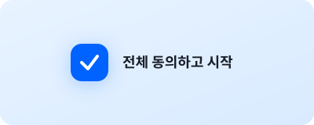
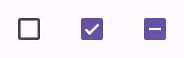
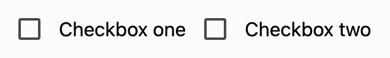

<!-- catalog-only-start --><!-- ---
name: Checkbox
dirname: checkbox
-----><!-- catalog-only-end -->

<catalog-component-header>
<catalog-component-header-title slot="title">

# Checkbox

<!--*
# Document freshness: For more information, see go/fresh-source.
freshness: {
  owner: 'lizmitchell'
  reviewed: '2026-07-31'
}
tag: 'docType:reference'
*-->

<!-- no-catalog-start -->

<!-- go/md-checkbox -->

<!-- [TOC] -->

<!-- external-only-start -->
**This documentation is fully rendered on the
[KakaoBank Material Web catalog](https://material-web.dev/components/checkbox/).**
<!-- external-only-end -->

<!-- no-catalog-end -->

[Checkboxes](https://m3.material.io/components/checkbox)<!-- {.external} --> allow users
to select one or more items from a set. Checkboxes can turn an option on or off.

There's one type of checkbox in Material. Use this selection control when the
user needs to select one or more options from a list.

</catalog-component-header-title>



</catalog-component-header>

<!-- KakaoBank Interactive Options Playground & Live Sandbox -->
<div class="kb-playground-container">
  <div class="kb-playground-header">
    <div class="kb-playground-title">
      <span>🛠️ Checkbox 옵션 실시간 미리보기 샌드박스</span>
      <span class="kb-playground-badge">Live Interactive</span>
    </div>
    <span style="font-size: 12px; color: #4E5968;">상태를 변경하면 컴포넌트와 코드가 실시간 갱신됩니다.</span>
  </div>
  <div class="kb-playground-body">
    <div class="kb-playground-controls">
      <div class="kb-control-group">
        <label class="kb-control-label" for="kb-check-state">체크 상태 (State):</label>
        <select id="kb-check-state" class="kb-control-select" onchange="updateCheckDemo()">
          <option value="checked" selected>Checked (선택됨)</option>
          <option value="indeterminate">Indeterminate (일부 선택)</option>
          <option value="unchecked">Unchecked (선택 안 됨)</option>
        </select>
      </div>
      <div class="kb-control-group">
        <label class="kb-control-label" for="kb-check-label">라벨 문구 (Label):</label>
        <input id="kb-check-label" class="kb-control-input" type="text" value="카카오뱅크 필수 금융거래 약관 동의" oninput="updateCheckDemo()" />
      </div>
      <div style="display: flex; flex-direction: column; gap: 8px; margin-top: 4px;">
        <label class="kb-control-checkbox">
          <input id="kb-check-disabled" type="checkbox" onchange="updateCheckDemo()" />
          <span>비활성화 (Disabled)</span>
        </label>
        <label class="kb-control-checkbox">
          <input id="kb-check-error" type="checkbox" onchange="updateCheckDemo()" />
          <span>오류 상태 (Error)</span>
        </label>
      </div>
    </div>
    <div class="kb-playground-canvas" id="kb-check-canvas">
      <!-- Live Render Target -->
      <label id="kb-check-wrapper" style="display: flex; align-items: center; gap: 12px; cursor: pointer; padding: 12px 18px; border-radius: 12px; border: 1px solid #E5E8EB; background: #FFFFFF; transition: all 0.2s;">
        <div id="kb-check-box" style="width: 22px; height: 22px; border-radius: 6px; background: #FFE100; border: 1.5px solid #191F28; display: flex; align-items: center; justify-content: center; font-weight: 800; font-size: 14px; color: #191F28; transition: all 0.15s;">
          ✓
        </div>
        <span id="kb-check-render-text" style="font-size: 15px; font-weight: 600; color: #191F28;">카카오뱅크 필수 금융거래 약관 동의</span>
      </label>
    </div>
  </div>
  <div class="kb-playground-footer">
    <pre class="kb-code-preview" id="kb-check-code">&lt;label&gt;
  &lt;md-checkbox checked&gt;&lt;/md-checkbox&gt;
  카카오뱅크 필수 금융거래 약관 동의
&lt;/label&gt;</pre>
    <button class="kb-copy-code-btn" type="button" onclick="navigator.clipboard.writeText(document.getElementById('kb-check-code').innerText); this.innerText='복사 완료!'; setTimeout(()=>this.innerText='코드 복사', 1500)">코드 복사</button>
  </div>
</div>

<script>
  function updateCheckDemo() {
    const state = document.getElementById('kb-check-state').value;
    const label = document.getElementById('kb-check-label').value || '약관 동의';
    const disabled = document.getElementById('kb-check-disabled').checked;
    const isError = document.getElementById('kb-check-error').checked;

    const box = document.getElementById('kb-check-box');
    const text = document.getElementById('kb-check-render-text');
    const wrap = document.getElementById('kb-check-wrapper');
    const code = document.getElementById('kb-check-code');

    text.innerText = label;

    if (disabled) {
      wrap.style.opacity = '0.38';
      wrap.style.cursor = 'not-allowed';
    } else {
      wrap.style.opacity = '1';
      wrap.style.cursor = 'pointer';
    }

    if (isError) {
      box.style.borderColor = '#F04452';
      text.style.color = '#F04452';
    } else {
      box.style.borderColor = '#191F28';
      text.style.color = '#191F28';
    }

    if (state === 'checked') {
      box.style.background = isError ? '#F04452' : '#FFE100';
      box.style.color = isError ? '#FFFFFF' : '#191F28';
      box.innerText = '✓';
    } else if (state === 'indeterminate') {
      box.style.background = isError ? '#F04452' : '#FFE100';
      box.style.color = isError ? '#FFFFFF' : '#191F28';
      box.innerText = '—';
    } else {
      box.style.background = '#FFFFFF';
      box.innerText = '';
    }

    const stateAttr = state === 'checked' ? ' checked' : (state === 'indeterminate' ? ' indeterminate' : '');
    const disAttr = disabled ? ' disabled' : '';
    const errAttr = isError ? ' error' : '';
    code.innerText = `<label>\n  <md-checkbox${stateAttr}${disAttr}${errAttr}></md-checkbox>\n  ${label}\n</label>`;
  }
</script>

*   [Design article](https://m3.material.io/components/checkbox) <!-- {.external} -->
*   [API Documentation](#api)
*   [Source code](https://github.com/material-components/material-web/tree/main/checkbox)
    <!-- {.external} -->

<!-- catalog-only-start -->

<!--

## Interactive Demo



-->

<!-- catalog-only-end -->

## Usage

Checkboxes may be standalone, pre-checked, or indeterminate.

<!-- no-catalog-start -->



<!-- no-catalog-end -->
<!-- catalog-include "figures/checkbox/usage.html" -->

```html
<md-checkbox touch-target="wrapper"></md-checkbox>
<md-checkbox touch-target="wrapper" checked></md-checkbox>
<md-checkbox touch-target="wrapper" indeterminate></md-checkbox>
```

### Label

Associate a label with a checkbox using the `<label>` element.

<!-- no-catalog-start -->



<!-- no-catalog-end -->
<!-- catalog-include "figures/checkbox/usage-label.html" -->

```html
<label>
  <md-checkbox touch-target="wrapper"></md-checkbox>
  Checkbox one
</label>

<md-checkbox id="checkbox-two" touch-target="wrapper"></md-checkbox>
<label for="checkbox-two">Checkbox two</label>
```

## Accessibility

Add an
[`aria-label`](https://developer.mozilla.org/en-US/docs/Web/Accessibility/ARIA/Attributes/aria-label)<!-- {.external} -->
attribute to checkboxes without labels or checkboxes whose labels need to be
more descriptive.

```html
<md-checkbox aria-label="Select all checkboxes"></md-checkbox>

<label>
  <md-checkbox aria-label="Agree to terms and conditions"></md-checkbox>
  Agree
</label>
```

> Note: checkboxes are not automatically labelled by `<label>` elements and
> always need an `aria-label`. See b/294081528.

## Theming

Checkbox supports [Material theming](../theming/README.md) and can be customized
in terms of color and shape.

### Tokens

Token                                    | Default value
---------------------------------------- | -----------------------------------
`--md-checkbox-outline-color`            | `--md-sys-color-on-surface-variant`
`--md-checkbox-selected-container-color` | `--md-sys-color-primary`
`--md-checkbox-selected-icon-color`      | `--md-sys-color-on-primary`
`--md-checkbox-container-shape`          | `2px`

*   [All tokens](https://github.com/material-components/material-web/blob/main/tokens/_md-comp-checkbox.scss)
    <!-- {.external} -->

### Example

<!-- no-catalog-start -->


<!-- no-catalog-end -->
<!-- catalog-include "figures/checkbox/theming.html" -->

```html
<style>
  :root {
    /* System tokens */
    --md-sys-color-primary: #006a6a;
    --md-sys-color-on-primary: #ffffff;
    --md-sys-color-on-surface-variant: #3f4948;

    /* Component tokens */
    --md-checkbox-container-shape: 0px;
  }
</style>

<md-checkbox touch-target="wrapper"></md-checkbox>
<md-checkbox touch-target="wrapper" checked></md-checkbox>
```

<!-- auto-generated API docs start -->

## API


### MdCheckbox <code>&lt;md-checkbox&gt;</code>

#### Properties

<!-- mdformat off(autogenerated might break rendering in catalog) -->

| Property | Attribute | Type | Default | Description |
| --- | --- | --- | --- | --- |
| `checked` | `checked` | `boolean` | `false` | Whether or not the checkbox is selected. |
| `indeterminate` | `indeterminate` | `boolean` | `false` | Whether or not the checkbox is indeterminate.<br>https://developer.mozilla.org/en-US/docs/Web/HTML/Element/input/checkbox#indeterminate_state_checkboxes |
| `required` | `required` | `boolean` | `false` | When true, require the checkbox to be selected when participating in form submission.<br>https://developer.mozilla.org/en-US/docs/Web/HTML/Element/input/checkbox#validation |
| `value` | `value` | `string` | `'on'` | The value of the checkbox that is submitted with a form when selected.<br>https://developer.mozilla.org/en-US/docs/Web/HTML/Element/input/checkbox#value |
| `name` | `name` | `string` | `undefined` | The HTML name to use in form submission. |
| `disabled` | `disabled` | `boolean` | `undefined` | Whether or not the element is disabled. |
| `form` |  | `HTMLFormElement` | `undefined` | The associated form element with which this element's value will submit. |
| `labels` |  | `NodeList` | `undefined` | The labels this element is associated with. |
| `validity` |  | `ValidityState` | `undefined` | Returns a ValidityState object that represents the validity states of the element.<br>https://developer.mozilla.org/en-US/docs/Web/API/ValidityState |
| `validationMessage` |  | `string` | `undefined` | Returns a validation error message or an empty string if the element is valid.<br>https://developer.mozilla.org/en-US/docs/Web/API/ElementInternals/validationMessage |
| `willValidate` |  | `boolean` | `undefined` | Returns whether an element will successfully validate based on forms validation rules and constraints.<br>Disabled and readonly elements will not validate.<br>https://developer.mozilla.org/en-US/docs/Web/API/ElementInternals/willValidate |

<!-- mdformat on(autogenerated might break rendering in catalog) -->

#### Methods

<!-- mdformat off(autogenerated might break rendering in catalog) -->

| Method | Parameters | Returns | Description |
| --- | --- | --- | --- |
| `formResetCallback` | _None_ | `void` |  |
| `formStateRestoreCallback` | `state` | `void` |  |
| `checkValidity` | _None_ | `boolean` | Checks the element's constraint validation and returns true if the element is valid or false if not.<br>If invalid, this method will dispatch an `invalid` event.<br>https://developer.mozilla.org/en-US/docs/Web/API/ElementInternals/checkValidity |
| `reportValidity` | _None_ | `boolean` | Checks the element's constraint validation and returns true if the element is valid or false if not.<br>If invalid, this method will dispatch a cancelable `invalid` event. If not canceled, a the current `validationMessage` will be reported to the user.<br>https://developer.mozilla.org/en-US/docs/Web/API/ElementInternals/reportValidity |
| `setCustomValidity` | `error` | `void` | Sets the element's constraint validation error message. When set to a non-empty string, `validity.customError` will be true and `validationMessage` will display the provided error.<br>Use this method to customize error messages reported.<br>https://developer.mozilla.org/en-US/docs/Web/API/HTMLInputElement/setCustomValidity |

<!-- mdformat on(autogenerated might break rendering in catalog) -->

#### Events

<!-- mdformat off(autogenerated might break rendering in catalog) -->

| Event | Type | [Bubbles](https://developer.mozilla.org/en-US/docs/Web/API/Event/bubbles) | [Composed](https://developer.mozilla.org/en-US/docs/Web/API/Event/composed) | Description |
| --- | --- | --- | --- | --- |
| `change` | `Event` | Yes | No | The native `change` event on [`<input>`](https://developer.mozilla.org/en-US/docs/Web/API/HTMLElement/change_event) |
| `input` | `InputEvent` | Yes | Yes | The native `input` event on [`<input>`](https://developer.mozilla.org/en-US/docs/Web/API/HTMLElement/input_event) |

<!-- mdformat on(autogenerated might break rendering in catalog) -->

<!-- auto-generated API docs end -->
