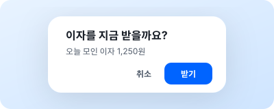

<!-- catalog-only-start --><!-- ---
name: Dialogs
dirname: dialog
-----><!-- catalog-only-end -->

<catalog-component-header image-align="start">
<catalog-component-header-title slot="title">

# Dialogs

<!--*
# Document freshness: For more information, see go/fresh-source.
freshness: { owner: 'lizmitchell' reviewed: '2026-07-31' }
tag: 'docType:reference'
*-->

<!-- no-catalog-start -->

<!-- go/md-dialog -->

<!-- [TOC] -->

<!-- external-only-start -->
**This documentation is fully rendered on the
[KakaoBank Material Web catalog](https://material-web.dev/components/dialog/)**
<!-- external-only-end -->

<!-- no-catalog-end -->

[Dialogs](https://m3.material.io/components/dialogs)<!-- {.external} --> provide
important prompts in a user flow.

</catalog-component-header-title>



</catalog-component-header>

<!-- KakaoBank Interactive Options Playground & Live Sandbox for Dialog -->
<div class="kb-playground-container">
  <div class="kb-playground-header">
    <div class="kb-playground-title">
      <span>🛠️ Dialog 옵션 실시간 미리보기 샌드박스</span>
      <span class="kb-playground-badge">KakaoBank M3</span>
    </div>
    <span style="font-size: 12px; color: #4E5968;">옵션을 변경하면 아래 다이얼로그 미리보기에 실시간 반영되며, 실제 팝업을 열어볼 수 있습니다.</span>
  </div>
  <div class="kb-playground-body">
    <div class="kb-playground-controls">
      <div class="kb-control-group">
        <label class="kb-control-label" for="kb-dlg-headline">제목 (Headline):</label>
        <input type="text" id="kb-dlg-headline" class="kb-control-input" value="계좌 이체를 진행할까요?">
      </div>
      <div class="kb-control-group">
        <label class="kb-control-label" for="kb-dlg-content">본문 (Supporting Text):</label>
        <textarea id="kb-dlg-content" class="kb-control-input" rows="2" style="resize: vertical;">받는 분: 카카오뱅크 3333-01-1234567&#10;이체 금액: 50,000원을 송금합니다.</textarea>
      </div>
      <div class="kb-control-group">
        <label class="kb-control-label" for="kb-dlg-icon">상단 아이콘 (Icon):</label>
        <select id="kb-dlg-icon" class="kb-control-select">
          <option value="check_circle">체크 아이콘 (check_circle)</option>
          <option value="info">정보 아이콘 (info)</option>
          <option value="warning">경고 아이콘 (warning)</option>
          <option value="none">아이콘 없음 (None)</option>
        </select>
      </div>
      <div class="kb-control-group">
        <label class="kb-control-label" for="kb-dlg-buttons">버튼 구성 (Buttons):</label>
        <select id="kb-dlg-buttons" class="kb-control-select">
          <option value="both">확인 + 취소 (기본)</option>
          <option value="confirm-only">확인만 (Single Action)</option>
        </select>
      </div>
      <div style="margin-top: 10px;">
        <button type="button" id="kb-open-real-dlg-btn" class="kb-open-dlg-trigger-btn">
          ✨ 실제 다이얼로그 팝업 열기 (Live Test)
        </button>
      </div>
    </div>
    <div class="kb-playground-preview" style="background: rgba(0,0,0,0.03); border: 1px dashed #D1D6DB; border-radius: 16px; padding: 24px; display: flex; flex-direction: column; align-items: center; justify-content: center; min-height: 280px;">
      <!-- KakaoBank Live Visual Mock Dialog -->
      <div id="kb-dlg-mock" style="width: 100%; max-width: 380px; background: #FFFFFF; border-radius: 24px; box-shadow: 0 16px 32px rgba(0,0,0,0.12), 0 4px 8px rgba(0,0,0,0.06); border: 1px solid #E5E8EB; overflow: hidden; display: flex; flex-direction: column;">
        <div id="kb-dlg-mock-icon-wrap" style="display: flex; justify-content: center; padding-top: 24px;">
          <div id="kb-dlg-mock-icon" style="width: 44px; height: 44px; border-radius: 50%; background: #FFF6A6; color: #191F28; display: flex; align-items: center; justify-content: center; font-size: 24px;">
            ✓
          </div>
        </div>
        <div style="padding: 16px 24px 0 24px; text-align: center;">
          <h3 id="kb-dlg-mock-headline" style="margin: 0; font-size: 19px; font-weight: 700; color: #191F28; letter-spacing: -0.02em;">계좌 이체를 진행할까요?</h3>
        </div>
        <div style="padding: 12px 24px 20px 24px; text-align: center;">
          <p id="kb-dlg-mock-content" style="margin: 0; font-size: 14px; line-height: 1.5; color: #4E5968; white-space: pre-line;">받는 분: 카카오뱅크 3333-01-1234567&#10;이체 금액: 50,000원을 송금합니다.</p>
        </div>
        <div id="kb-dlg-mock-actions" style="display: flex; gap: 8px; justify-content: flex-end; padding: 12px 20px 18px 20px; border-top: 1px solid #F2F4F6;">
          <button type="button" id="kb-dlg-mock-cancel" style="padding: 9px 18px; border-radius: 10px; border: 1px solid #E5E8EB; background: #FFFFFF; color: #4E5968; font-weight: 600; font-size: 14px; cursor: pointer;">취소</button>
          <button type="button" id="kb-dlg-mock-confirm" style="padding: 9px 20px; border-radius: 10px; border: none; background: #FFE100; color: #191F28; font-weight: 700; font-size: 14px; cursor: pointer; box-shadow: 0 2px 4px rgba(0,0,0,0.06);">확인</button>
        </div>
      </div>
    </div>
  </div>
</div>

<!-- Actual md-dialog for live interactive trigger -->
<md-dialog id="kb-live-dialog">
  <div slot="headline" id="kb-live-dialog-headline">계좌 이체를 진행할까요?</div>
  <form id="form" slot="content" method="dialog">
    <span id="kb-live-dialog-content">받는 분: 카카오뱅크 3333-01-1234567<br>이체 금액: 50,000원을 송금합니다.</span>
  </form>
  <div slot="actions">
    <md-text-button form="form" value="cancel" id="kb-live-dialog-cancel">취소</md-text-button>
    <md-filled-button form="form" value="ok" autofocus id="kb-live-dialog-ok">확인</md-filled-button>
  </div>
</md-dialog>

<style>
.kb-open-dlg-trigger-btn {
  width: 100%;
  padding: 10px 16px;
  background: #FFE100;
  color: #191F28;
  font-weight: 700;
  font-size: 13px;
  border: none;
  border-radius: 10px;
  cursor: pointer;
  box-shadow: 0 2px 6px rgba(0,0,0,0.08);
  transition: transform 0.1s ease, background-color 0.15s ease;
}
.kb-open-dlg-trigger-btn:hover {
  background: #FFD200;
  transform: translateY(-1px);
}
.kb-open-dlg-trigger-btn:active {
  transform: translateY(0);
}
</style>

<script>
(function() {
  function initDlgPlayground() {
    const headlineInp = document.getElementById('kb-dlg-headline');
    const contentInp = document.getElementById('kb-dlg-content');
    const iconSelect = document.getElementById('kb-dlg-icon');
    const buttonSelect = document.getElementById('kb-dlg-buttons');
    const openBtn = document.getElementById('kb-open-real-dlg-btn');

    const mockHeadline = document.getElementById('kb-dlg-mock-headline');
    const mockContent = document.getElementById('kb-dlg-mock-content');
    const mockIconWrap = document.getElementById('kb-dlg-mock-icon-wrap');
    const mockIcon = document.getElementById('kb-dlg-mock-icon');
    const mockCancel = document.getElementById('kb-dlg-mock-cancel');
    const mockConfirm = document.getElementById('kb-dlg-mock-confirm');

    const liveDlg = document.getElementById('kb-live-dialog');
    const liveHeadline = document.getElementById('kb-live-dialog-headline');
    const liveContent = document.getElementById('kb-live-dialog-content');
    const liveCancel = document.getElementById('kb-live-dialog-cancel');

    if (!headlineInp || !mockHeadline) return;

    function updateMock() {
      const hText = headlineInp.value || '제목 없음';
      const cText = contentInp.value || '본문 없음';
      mockHeadline.textContent = hText;
      mockContent.textContent = cText;

      const iconVal = iconSelect.value;
      if (iconVal === 'none') {
        mockIconWrap.style.display = 'none';
      } else {
        mockIconWrap.style.display = 'flex';
        if (iconVal === 'check_circle') {
          mockIcon.textContent = '✓';
          mockIcon.style.background = '#FFF6A6';
          mockIcon.style.color = '#191F28';
        } else if (iconVal === 'warning') {
          mockIcon.textContent = '⚠️';
          mockIcon.style.background = '#FFF0F0';
          mockIcon.style.color = '#E53E3E';
        } else {
          mockIcon.textContent = 'ℹ️';
          mockIcon.style.background = '#E8F3FF';
          mockIcon.style.color = '#3182F6';
        }
      }

      if (buttonSelect.value === 'confirm-only') {
        mockCancel.style.display = 'none';
        mockConfirm.style.width = '100%';
      } else {
        mockCancel.style.display = 'inline-block';
        mockConfirm.style.width = 'auto';
      }
    }

    headlineInp.addEventListener('input', updateMock);
    contentInp.addEventListener('input', updateMock);
    iconSelect.addEventListener('change', updateMock);
    buttonSelect.addEventListener('change', updateMock);

    if (openBtn && liveDlg) {
      openBtn.addEventListener('click', function() {
        if (liveHeadline) liveHeadline.textContent = headlineInp.value;
        if (liveContent) liveContent.innerHTML = contentInp.value.replace(/\n/g, '<br>');
        if (liveCancel) {
          liveCancel.style.display = (buttonSelect.value === 'confirm-only') ? 'none' : 'inline-flex';
        }
        liveDlg.show();
      });
    }

    updateMock();
  }

  if (document.readyState === 'loading') {
    document.addEventListener('DOMContentLoaded', initDlgPlayground);
  } else {
    initDlgPlayground();
  }
})();
</script>

*   [Design article](https://m3.material.io/components/dialogs) <!-- {.external} -->
*   [API Documentation](#api)
*   [Source code](https://github.com/material-components/material-web/tree/main/dialog)
    <!-- {.external} -->

<!-- catalog-only-start -->

<!--

## Interactive Demo



-->

<!-- catalog-only-end -->

## Usage

Dialogs behave like
[`<dialog>`](https://developer.mozilla.org/en-US/docs/Web/API/HTMLDialogElement)<!-- {.external} -->
elements, and can be closed with a `<form method="dialog">` element.

Dialogs have three optional sections: the headline title, the main content, and
action buttons.

```html
<md-dialog>
  <div slot="headline">
    Dialog title
  </div>
  <form slot="content" id="form-id" method="dialog">
    A simple dialog with free-form content.
  </form>
  <div slot="actions">
    <md-text-button form="form-id">Ok</md-text-button>
  </div>
</md-dialog>
```

<!-- no-catalog-start -->
<!-- Need to add image -->
<!-- no-catalog-end -->
<!-- Need to add catalog-include "figures/<component>/usage.html" -->

> Tip: use `margin`, `height`, and `width` CSS properties to control the
> dialog's size and position.

### Opening and closing

Dialogs are opened and closed by setting the `open` attribute or property.

```html
<md-dialog open>
  <div slot="content">
    A dialog that is opened by default.
  </div>
</md-dialog>
```

Dialogs are also opened and closed by calling `dialog.show()` and
`dialog.close()`.

Both return a Promise that resolves after the dialog's animation finishes.

```ts
closeButton.addEventListener('click', async () => {
  await dialog.close();
});
```

### Return value

A button's value attribute will set the dialog's `returnValue` property to
identify which button closed it.

```html
<md-dialog open>
  <form slot="content" id="form-id" method="dialog">...</form>
  <div slot="actions">
    <md-text-button form="form-id" value="cancel">Cancel</md-text-button>
    <md-text-button form="form-id" value="ok">Ok</md-text-button>
  </div>
</md-dialog>
```

```ts
dialog.addEventListener('close', () => {
  const cancelClicked = dialog.returnValue === 'cancel';
  const okClicked = dialog.returnValue === 'ok';
});
```

## Accessibility

Dialogs are labelled by their headlines. Add an
[`aria-label`](https://developer.mozilla.org/en-US/docs/Web/Accessibility/ARIA/Attributes/aria-label)<!-- {.external} -->
attribute to dialogs without a headline.

```html
<md-dialog aria-label="Error message">
  <div slot="content">An error occurred, details ...</div>
</md-dialog>
```

### Alerts

Add a
[`type="alert"`](https://developer.mozilla.org/en-US/docs/Web/Accessibility/ARIA/Roles/alertdialog_role)
attribute to dialogs that need to communicate an important message and require a
user's response.

Common examples include error messages that require confirmation and other
action confirmation prompts.

```html
<md-dialog type="alert">
  <div slot="headline">Confirm deletion</div>
  <form slot="content" id="form-id" method="dialog">
    Are you sure you wish to delete this item?
  </form>
  <div slot="actions">
    <md-text-button form="form-id" value="cancel">Cancel</md-text-button>
    <md-text-button form="form-id" value="delete">Delete</md-text-button>
  </div>
</md-dialog>
```

## Theming

Dialogs supports [Material theming](../theming/README.md) and can be customized
in terms of color, typography, and shape.

### Tokens

Token                               | Default value
----------------------------------- | ---------------------------------------
`--md-dialog-container-color`       | `--md-sys-color-surface-container-high`
`--md-dialog-headline-color`        | `--md-sys-color-on-surface`
`--md-dialog-headline-font`         | `--md-sys-typescale-headline-small-font`
`--md-dialog-supporting-text-color` | `--md-sys-color-on-surface-variant`
`--md-dialog-supporting-text-font`  | `--md-sys-typescale-body-medium-font`

*   [All tokens](https://github.com/material-components/material-web/blob/main/tokens/_md-comp-dialog.scss)
    <!-- {.external} -->

### Example

<!-- no-catalog-start -->
<!-- Need to add image -->
<!-- no-catalog-end -->
<!-- Need to add catalog-include "figures/<component>/usage.html" -->

```html
<style>
:root {
  /* System tokens */
  --md-sys-color-surface-container-highest: #dde4e3;
  --md-sys-color-on-surface: #161d1d;
  --md-sys-color-on-surface-variant: #3f4948;
  --md-sys-typescale-body-medium: system-ui 16px/24px;
  --md-sys-typescale-headline-small: system-ui 24px/32px;

  /* Component tokens */
  --md-dialog-container-shape: 0px;
}
</style>

<md-dialog>
  <div slot="headline">Title</div>
  <div slot="content">Dialog content</div>
</md-dialog>
```

<!-- auto-generated API docs start -->

## API


### MdDialog <code>&lt;md-dialog&gt;</code>

#### Properties

<!-- mdformat off(autogenerated might break rendering in catalog) -->

| Property | Attribute | Type | Default | Description |
| --- | --- | --- | --- | --- |
| `quick` | `quick` | `boolean` | `false` | Skips the opening and closing animations. |
| `returnValue` |  | `string` | `''` | Gets or sets the dialog's return value, usually to indicate which button a user pressed to close it.<br>https://developer.mozilla.org/en-US/docs/Web/API/HTMLDialogElement/returnValue |
| `type` | `type` | `string` | `undefined` | The type of dialog for accessibility. Set this to `alert` to announce a dialog as an alert dialog. |
| `noFocusTrap` | `no-focus-trap` | `boolean` | `false` | Disables focus trapping, which by default keeps keyboard Tab navigation within the dialog.<br>When disabled, after focusing the last element of a dialog, pressing Tab again will release focus from the window back to the browser (such as the URL bar).<br>Focus trapping is recommended for accessibility, and should not typically be disabled. Only turn this off if the use case of a dialog is more accessible without focus trapping. |
| `open` | `open` | `boolean` | `undefined` |  |
| `getOpenAnimation` |  | `() => DialogAnimation` | `function { ... }` | Gets the opening animation for a dialog. Set to a new function to customize the animation. |
| `getCloseAnimation` |  | `() => DialogAnimation` | `function { ... }` | Gets the closing animation for a dialog. Set to a new function to customize the animation. |

<!-- mdformat on(autogenerated might break rendering in catalog) -->

#### Methods

<!-- mdformat off(autogenerated might break rendering in catalog) -->

| Method | Parameters | Returns | Description |
| --- | --- | --- | --- |
| `show` | _None_ | `Promise<void>` | Opens the dialog and fires a cancelable `open` event. After a dialog's animation, an `opened` event is fired.<br>Add an `autofocus` attribute to a child of the dialog that should receive focus after opening. |
| `close` | `returnValue` | `Promise<void>` | Closes the dialog and fires a cancelable `close` event. After a dialog's animation, a `closed` event is fired. |

<!-- mdformat on(autogenerated might break rendering in catalog) -->

#### Events

<!-- mdformat off(autogenerated might break rendering in catalog) -->

| Event | Type | [Bubbles](https://developer.mozilla.org/en-US/docs/Web/API/Event/bubbles) | [Composed](https://developer.mozilla.org/en-US/docs/Web/API/Event/composed) | Description |
| --- | --- | --- | --- | --- |
| `open` | `Event` | No | No | Dispatched when the dialog is opening before any animations. |
| `opened` | `Event` | No | No | Dispatched when the dialog has opened after any animations. |
| `close` | `Event` | No | No | Dispatched when the dialog is closing before any animations. |
| `closed` | `Event` | No | No | Dispatched when the dialog has closed after any animations. |
| `cancel` | `Event` | No | No | Dispatched when the dialog has been canceled by clicking on the scrim or pressing Escape. |

<!-- mdformat on(autogenerated might break rendering in catalog) -->

<!-- auto-generated API docs end -->
