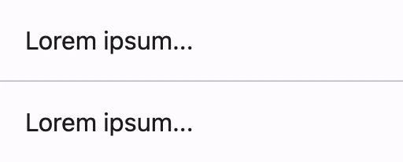
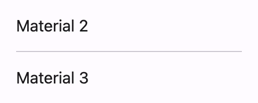
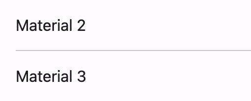
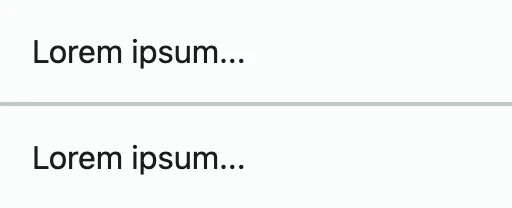

# Divider

<!--*
# Document freshness: For more information, see go/fresh-source.
freshness: { owner: 'lizmitchell' reviewed: '2026-07-31' }
tag: 'docType:reference'
*-->

<!-- go/md-divider -->

<!-- [TOC] -->

A [divider](https://m3.material.io/components/divider)<!-- {.external} --> is a thin line
that groups content in lists and containers.

Dividers can reinforce tapability, such as when used to separate list items or
define tappable regions in an accordion.


<!-- KakaoBank Interactive Options Playground & Live Sandbox -->
<div class="kb-playground-container">
  <div class="kb-playground-header">
    <div class="kb-playground-title">
      <span>🛠️ Divider (구분선) 실시간 옵션 샌드박스</span>
      <span class="kb-playground-badge">Live Interactive</span>
    </div>
    <span style="font-size: 12px; color: #4E5968;">구분선 인셋 형태와 두께, 색상을 실시간으로 변경해보세요.</span>
  </div>
  <div class="kb-playground-body">
    <div class="kb-playground-controls">
      <div class="kb-control-group">
        <label class="kb-control-label" for="kb-div-inset">인셋 형태 (Inset):</label>
        <select id="kb-div-inset" class="kb-control-select" onchange="updateDividerDemo()">
          <option value="none" selected>Full Width (전체 너비 100%)</option>
          <option value="inset">Inset (시작 지점 16px 인셋)</option>
          <option value="middle">Middle Inset (좌우 24px 여백)</option>
        </select>
      </div>
      <div class="kb-control-group">
        <label class="kb-control-label" for="kb-div-thickness">구분선 두께 (Thickness):</label>
        <select id="kb-div-thickness" class="kb-control-select" onchange="updateDividerDemo()">
          <option value="1" selected>1px (기본 세퍼레이터)</option>
          <option value="2">2px (강조 디바이더)</option>
          <option value="8">8px (섹션 분리 블록)</option>
        </select>
      </div>
      <div class="kb-control-group">
        <label class="kb-control-label" for="kb-div-color">구분선 색상 (Color):</label>
        <select id="kb-div-color" class="kb-control-select" onchange="updateDividerDemo()">
          <option value="#E5E8EB" selected>연한 그레이 (#E5E8EB)</option>
          <option value="#FFE100">카카오 옐로우 (#FFE100)</option>
          <option value="#191F28">다크 차콜 (#191F28)</option>
        </select>
      </div>
    </div>
    <div class="kb-playground-canvas" id="kb-div-canvas" style="min-height: 160px; display: flex; flex-direction: column; justify-content: center; align-items: center; padding: 20px;">
      <div style="width: 100%; max-width: 400px; background: #FFFFFF; border: 1px solid #E5E8EB; border-radius: 14px; padding: 16px 0;">
        <div style="padding: 0 16px 12px; font-size: 14px; font-weight: 700; color: #191F28;">상단 계좌 정보 섹션</div>
        <div id="kb-div-render" style="width: 100%; height: 1px; background: #E5E8EB; transition: all 0.2s ease;"></div>
        <div style="padding: 12px 16px 0; font-size: 14px; color: #4E5968;">하단 거래 내역 섹션</div>
      </div>
    </div>
  </div>
  <div class="kb-playground-footer">
    <pre class="kb-code-preview" id="kb-div-code">&lt;md-divider&gt;&lt;/md-divider&gt;</pre>
    <button class="kb-copy-code-btn" type="button" onclick="navigator.clipboard.writeText(document.getElementById('kb-div-code').innerText); this.innerText='복사 완료!'; setTimeout(()=>this.innerText='코드 복사', 1500)">코드 복사</button>
  </div>
</div>
<script>
  function updateDividerDemo() {
    const inset = document.getElementById('kb-div-inset').value;
    const thickness = document.getElementById('kb-div-thickness').value;
    const color = document.getElementById('kb-div-color').value;

    const div = document.getElementById('kb-div-render');
    const code = document.getElementById('kb-div-code');

    div.style.height = thickness + 'px';
    div.style.background = color;

    if (inset === 'none') {
      div.style.width = '100%';
      div.style.margin = '0';
    } else if (inset === 'inset') {
      div.style.width = 'calc(100% - 16px)';
      div.style.margin = '0 0 0 16px';
    } else if (inset === 'middle') {
      div.style.width = 'calc(100% - 48px)';
      div.style.margin = '0 auto';
    }

    const insetAttribute = inset === 'inset' ? ' inset' : (inset === 'middle' ? ' inset-start inset-end' : '');
    code.innerText = `<md-divider${insetAttribute} style="--md-divider-thickness: ${thickness}px; --md-divider-color: ${color};"></md-divider>`;
  }
</script>

*   [Design article](https://m3.material.io/components/divider) <!-- {.external} -->
*   [API Documentation](#api)
*   [Source code](https://github.com/material-components/material-web/tree/main/divider)
    <!-- {.external} -->

## Usage

Use full width dividers to separate larger sections of unrelated content.



```html
<section>
  <p>Lorem ipsum...</p>
  <md-divider></md-divider>
  <p>Lorem ipsum...</p>
</section>
```

### Inset dividers

Use inset dividers to separate related content within a section.



```html
<section>
  <p>Material 2</p>
  <md-divider inset></md-divider>
  <p>Material 3</p>
</section>
```

Inset dividers are equally indented from both sides of the screen by default.
Use `inset-start` or `inset-end` to change this.



```html
<section>
  <p>Material 2</p>
  <md-divider inset-start></md-divider>
  <p>Material 3</p>
</section>
```

## Accessibility

Dividers are decorative by default and not announced by assistive technology.

Add a
[`role="separator"`](https://developer.mozilla.org/en-US/docs/Web/Accessibility/ARIA/Roles/separator_role)<!-- {.external} -->
attribute to non-decorative dividers that should be announced.

```html
<ul>
  <li>Item one</li>
  <md-divider inset></md-divider>
  <li>Item two</li>
  <md-divider role="separator"></md-divider>
  <li>Item three</li>
  <md-divider inset></md-divider>
  <li>Item four</li>
</ul>
```

## Theming

Divider supports [theming](../theming/README.md) and can be customized with CSS
custom property tokens.

### Tokens

Token                    | Default value
------------------------ | --------------------------------
`--md-divider-color`     | `--md-sys-color-outline-variant`
`--md-divider-thickness` | `1px`

*   [All tokens](https://github.com/material-components/material-web/blob/main/tokens/_md-comp-divider.scss)
    <!-- {.external} -->

### Example



```html
<style>
:root {
  --md-sys-color-outline-variant: #BEC9C8;
  --md-divider-thickness: 2px;
}
</style>

<section>
  <p>Lorem ipsum...</p>
  <md-divider></md-divider>
  <p>Lorem ipsum...</p>
</section>
```

<!-- auto-generated API docs start -->

## API


### MdDivider <code>&lt;md-divider&gt;</code>

#### Properties

<!-- mdformat off(autogenerated might break rendering in catalog) -->

| Property | Attribute | Type | Default | Description |
| --- | --- | --- | --- | --- |
| `inset` | `inset` | `boolean` | `false` | Indents the divider with equal padding on both sides. |
| `insetStart` | `inset-start` | `boolean` | `false` | Indents the divider with padding on the leading side. |
| `insetEnd` | `inset-end` | `boolean` | `false` | Indents the divider with padding on the trailing side. |

<!-- mdformat on(autogenerated might break rendering in catalog) -->

<!-- auto-generated API docs end -->
