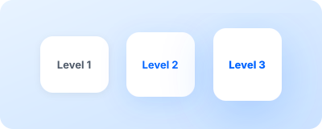
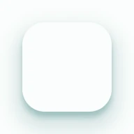

# Elevation

<!--*
# Document freshness: For more information, see go/fresh-source.
freshness: { owner: 'lizmitchell' reviewed: '2026-07-31' }
tag: 'docType:reference'
*-->

<!-- go/md-elevation -->

<!-- [TOC] -->

[Elevation](https://m3.material.io/styles/elevation)<!-- {.external} --> is the relative
distance between two surfaces along the z-axis.

Material's elevation system is deliberately limited to just a handful of levels.
This creative constraint means you need to make thoughtful decisions about your
UI’s elevation story.



<!-- Toss Bank Interactive Options Playground & Live Sandbox -->
<div class="tb-playground-container">
  <div class="tb-playground-header">
    <div class="tb-playground-title">
      <span>🛠️ Elevation (입체감 & 그림자) 실시간 옵션 샌드박스</span>
      <span class="tb-playground-badge">Live Interactive</span>
    </div>
    <span style="font-size: 12px; color: #4E5968;">토스뱅크 카드의 0~5단계 그림자 레벨을 실시간으로 조작해보세요.</span>
  </div>
  <div class="tb-playground-body">
    <div class="tb-playground-controls">
      <div class="tb-control-group">
        <label class="tb-control-label" for="tb-elev-level">그림자 레벨 (Level: <span id="tb-elev-num">2</span>):</label>
        <input id="tb-elev-level" type="range" min="0" max="5" value="2" oninput="updateElevDemo()" style="width: 100%; accent-color: #0064FF; cursor: pointer;" />
      </div>
      <div class="tb-control-group">
        <label class="tb-control-label" for="tb-elev-radius">코너 곡률 (Border Radius):</label>
        <select id="tb-elev-radius" class="tb-control-select" onchange="updateElevDemo()">
          <option value="16" selected>16px (토스뱅크 표준 스쿼클 카드)</option>
          <option value="24">24px (다이얼로그 및 바텀시트)</option>
          <option value="8">8px (콤팩트 박스)</option>
        </select>
      </div>
      <div style="display: flex; flex-direction: column; gap: 8px; margin-top: 4px;">
        <label class="tb-control-checkbox">
          <input id="tb-elev-border" type="checkbox" checked onchange="updateElevDemo()" />
          <span>토스 딥블루 액센트 보더 (Signature Blue Border)</span>
        </label>
      </div>
    </div>
    <div class="tb-playground-canvas" id="tb-elev-canvas" style="min-height: 200px; display: flex; justify-content: center; align-items: center; padding: 24px;">
      <div id="tb-elev-render" style="width: 260px; height: 140px; background: #FFFFFF; border-radius: 16px; border: 1.5px solid #0064FF; box-shadow: 0 4px 14px rgba(0,0,0,0.08); display: flex; flex-direction: column; align-items: center; justify-content: center; transition: all 0.25s ease;">
        <span style="font-size: 18px; font-weight: 800; color: #191F28;" id="tb-elev-label">Elevation Level 2</span>
        <span style="font-size: 12px; color: #76808E; margin-top: 4px;" id="tb-elev-sub">토스뱅크 시그니처 카드</span>
      </div>
    </div>
  </div>
  <div class="tb-playground-footer">
    <pre class="tb-code-preview" id="tb-elev-code">&lt;div style="position: relative; border-radius: 16px; border: 1.5px solid #0064FF;"&gt;
  &lt;md-elevation style="--md-elevation-level: 2;"&gt;&lt;/md-elevation&gt;
  토스뱅크 카드 (Level 2)
&lt;/div&gt;</pre>
    <button class="tb-copy-code-btn" type="button" onclick="navigator.clipboard.writeText(document.getElementById('tb-elev-code').innerText); this.innerText='복사 완료!'; setTimeout(()=>this.innerText='코드 복사', 1500)">코드 복사</button>
  </div>
</div>
<script>
  function updateElevDemo() {
    const level = Number(document.getElementById('tb-elev-level').value);
    const radius = document.getElementById('tb-elev-radius').value;
    const hasBorder = document.getElementById('tb-elev-border').checked;

    document.getElementById('tb-elev-num').innerText = level;
    const card = document.getElementById('tb-elev-render');
    const label = document.getElementById('tb-elev-label');
    const sub = document.getElementById('tb-elev-sub');
    const code = document.getElementById('tb-elev-code');

    label.innerText = 'Elevation Level ' + level;
    card.style.borderRadius = radius + 'px';
    card.style.border = hasBorder ? '1.5px solid #0064FF' : '1px solid #E5E8EB';

    const shadows = [
      'none',
      '0 1px 3px rgba(0,0,0,0.06)',
      '0 4px 14px rgba(0,0,0,0.08)',
      '0 8px 24px rgba(0,0,0,0.12)',
      '0 12px 36px rgba(0,0,0,0.16)',
      '0 20px 48px rgba(0,0,0,0.22)'
    ];
    const subs = [
      'Flat (바닥 서피스에 밀착된 상태)',
      'Level 1 (미세한 분리형 카드)',
      'Level 2 (토스뱅크 시그니처 카드)',
      'Level 3 (호버 및 활성 카드 부유 상태)',
      'Level 4 (모달 다이얼로그 및 바텀시트)',
      'Level 5 (최상위 알림 및 팝업)'
    ];

    card.style.boxShadow = shadows[level];
    sub.innerText = subs[level];

    code.innerText = `<div style="position: relative; border-radius: ${radius}px; ${hasBorder ? 'border: 1.5px solid #0064FF;' : ''}">\n  <md-elevation style="--md-elevation-level: ${level};"></md-elevation>\n  토스뱅크 카드 (Level ${level})\n</div>`;
  }
</script>

*   [Design article](https://m3.material.io/styles/elevation) <!-- {.external} -->
*   [API Documentation](#api)
*   [Source code](https://github.com/material-components/material-web/tree/main/elevation)
    <!-- {.external} -->

## Usage

Elevation can be set from 0 to 5 using the `--md-elevation-level` CSS custom
property. The elevation will automatically fill the nearest `position: relative`
element's size and shape.


```html
<style>
  .surface {
    position: relative;
    border-radius: 16px;
    height: 64px;
    width: 64px;

    --md-elevation-level: 3;
  }
</style>
<div class="surface">
  <md-elevation></md-elevation>
  <!-- Content -->
</div>
```

### Animation

Shadows may be animated between levels by adding `transition-duration` and
`transition-easing-function` CSS properties.


```html
<style>
  .surface {
    /* ... */
    transition-duration: 250ms;
    transition-timing-function: ease-in-out;

    --md-elevation-level: 3;
  }

  .surface:active {
    --md-elevation-level: 0;
  }
</style>
<div class="surface">
  <md-elevation></md-elevation>
  <!-- Content -->
</div>
```

## Accessibility

Elevation is a visual component and does not have accessibility concerns.

## Theming

Elevation supports [Material theming](../theming/README.md) and can be
customized in terms of color.

### Tokens

Token                         | Default value
----------------------------- | -----------------------
`--md-elevation-level`        | `0`
`--md-elevation-shadow-color` | `--md-sys-color-shadow`

*   [All tokens](https://github.com/material-components/material-web/blob/main/tokens/_md-comp-elevation.scss)
    <!-- {.external} -->

### Example



```html
<style>
  .surface {
    position: relative;
    border-radius: 16px;
    height: 64px;
    width: 64px;
  }

  :root {
    --md-elevation-level: 5;
    --md-sys-color-shadow: #006A6A;
  }
</style>
<div class="surface">
  <md-elevation></md-elevation>
  <!-- Content -->
</div>
```

<!-- auto-generated API docs start -->
<!-- auto-generated API docs end -->
