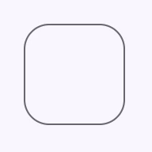
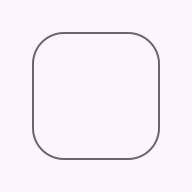
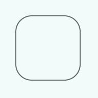

# Focus ring

<!--*
# Document freshness: For more information, see go/fresh-source.
freshness: { owner: 'lizmitchell' reviewed: '2026-07-31' }
tag: 'docType:reference'
*-->

<!-- go/md-focus-ring -->

<!-- [TOC] -->

Focus rings are accessible outlines for components to show keyboard focus.

Focus rings follow the same heuristics as
[`:focus-visible`](https://developer.mozilla.org/en-US/docs/Web/CSS/:focus-visible)<!-- {.external} -->
to determine when they are visible.


<!-- KakaoBank Interactive Options Playground & Live Sandbox -->
<div class="kb-playground-container">
  <div class="kb-playground-header">
    <div class="kb-playground-title">
      <span>🛠️ Focus Ring (웹 접근성 포커스 링) 실시간 옵션 샌드박스</span>
      <span class="kb-playground-badge">Live Interactive</span>
    </div>
    <span style="font-size: 12px; color: #4E5968;">키보드 내비게이션 시 표시되는 고대비 포커스 링 옵션을 실시간 조작해보세요.</span>
  </div>
  <div class="kb-playground-body">
    <div class="kb-playground-controls">
      <div class="kb-control-group">
        <label class="kb-control-label" for="kb-ring-color">포커스 링 색상 (Color):</label>
        <select id="kb-ring-color" class="kb-control-select" onchange="updateRingDemo()">
          <option value="#FFE100" selected>카카오 옐로우 (#FFE100 / 고대비)</option>
          <option value="#191F28">다크 차콜 (#191F28)</option>
          <option value="#3182F6">포인트 블루 (#3182F6)</option>
        </select>
      </div>
      <div class="kb-control-group">
        <label class="kb-control-label" for="kb-ring-width">링 두께 (Width):</label>
        <select id="kb-ring-width" class="kb-control-select" onchange="updateRingDemo()">
          <option value="3" selected>3px (카카오뱅크 권장)</option>
          <option value="2">2px (슬림)</option>
          <option value="4">4px (초고대비)</option>
        </select>
      </div>
      <div class="kb-control-group">
        <label class="kb-control-label" for="kb-ring-offset">링 오프셋 간격 (Offset):</label>
        <select id="kb-ring-offset" class="kb-control-select" onchange="updateRingDemo()">
          <option value="2" selected>2px (표준 여백)</option>
          <option value="0">0px (밀착)</option>
          <option value="4">4px (넓은 여백)</option>
        </select>
      </div>
    </div>
    <div class="kb-playground-canvas" id="kb-ring-canvas" style="min-height: 180px; display: flex; justify-content: center; align-items: center; padding: 24px;">
      <button id="kb-ring-render" type="button" style="height: 52px; padding: 0 24px; border-radius: 16px; border: none; background: #191F28; color: #FFFFFF; font-size: 16px; font-weight: 700; cursor: pointer; outline: 3px solid #FFE100; outline-offset: 2px; transition: all 0.2s ease;">
        포커스 활성 버튼 (Tab Focus)
      </button>
    </div>
  </div>
  <div class="kb-playground-footer">
    <pre class="kb-code-preview" id="kb-ring-code">&lt;button style="position: relative;"&gt;
  &lt;md-focus-ring style="--md-focus-ring-color: #FFE100; --md-focus-ring-width: 3px; --md-focus-ring-offset: 2px;"&gt;&lt;/md-focus-ring&gt;
  카카오뱅크 버튼
&lt;/button&gt;</pre>
    <button class="kb-copy-code-btn" type="button" onclick="navigator.clipboard.writeText(document.getElementById('kb-ring-code').innerText); this.innerText='복사 완료!'; setTimeout(()=>this.innerText='코드 복사', 1500)">코드 복사</button>
  </div>
</div>
<script>
  function updateRingDemo() {
    const color = document.getElementById('kb-ring-color').value;
    const width = document.getElementById('kb-ring-width').value;
    const offset = document.getElementById('kb-ring-offset').value;

    const btn = document.getElementById('kb-ring-render');
    const code = document.getElementById('kb-ring-code');

    btn.style.outline = `${width}px solid ${color}`;
    btn.style.outlineOffset = `${offset}px`;

    code.innerText = `<button style="position: relative;">\n  <md-focus-ring style="--md-focus-ring-color: ${color}; --md-focus-ring-width: ${width}px; --md-focus-ring-offset: ${offset}px;"></md-focus-ring>\n  카카오뱅크 버튼\n</button>`;
  }
</script>

*   [API Documentation](#api)
*   [Source code](https://github.com/material-components/material-web/tree/main/focus)
    <!-- {.external} -->

## Usage

Focus rings display on keyboard navigation. They may be attached to a control in
one of three ways.



1.  Attached to the parent element

    ```html
    <button style="position: relative">
      <md-focus-ring style="--md-focus-ring-shape: 8px"></md-focus-ring>
    </button>
    ```

1.  Attached to a referenced element

    ```html
    <div style="position: relative">
      <md-focus-ring for="control" style="--md-focus-ring-shape: 8px"></md-focus-ring>
      <input id="control">
    </div>
    ```

1.  Attached imperatively

    ```html
    <div style="position: relative">
      <md-focus-ring id="ring" style="--md-focus-ring-shape: 8px"></md-focus-ring>
      <button id="ring-control"></button>
    </div>
    <script>
      const focusRing = document.querySelector('#ring');
      const control = document.querySelector('#ring-control');
      focusRing.attach(control);
    </script>
    ```

> Note: focus rings must be placed within a `position: relative` container.

### Inward

Focus rings can be changed to animate inwards by adding an `inward` attribute.
This is useful for components like list items.



```html
<button style="position: relative">
  <md-focus-ring inward style="--md-focus-ring-shape: 8px"></md-focus-ring>
</button>
```

### Animation

The focus ring animation may be customized or disabled using CSS custom
properties.


```html
<style>
  md-focus-ring {
    --md-focus-ring-duration: 0s; /* disabled animation */
  }
</style>
```

## Accessibility

Focus rings are visual components and do not have assistive technology
requirements.

## Theming

Focus rings supports [Material theming](../theming/README.md) and can be
customized in terms of color and shape.

### Tokens

Token                   | Default value
----------------------- | --------------------------
`--md-focus-ring-color` | `--md-sys-color-secondary`
`--md-focus-ring-shape` | `--md-sys-shape-corner-full`
`--md-focus-ring-width` | `3px`

*   [All tokens](https://github.com/material-components/material-web/blob/main/tokens/_md-comp-focus-ring.scss)
    <!-- {.external} -->

### Example



```html
<style>
md-focus-ring {
  --md-focus-ring-shape: 0px;
  --md-focus-ring-width: 2px;
  --md-focus-ring-active-width: 4px;
  --md-sys-color-secondary: #4A6363;
}
</style>

<button>
  <md-focus-ring></md-focus-ring>
</button>
```

<!-- auto-generated API docs start -->

## API


### MdFocusRing <code>&lt;md-focus-ring&gt;</code>

#### Properties

<!-- mdformat off(autogenerated might break rendering in catalog) -->

| Property | Attribute | Type | Default | Description |
| --- | --- | --- | --- | --- |
| `visible` | `visible` | `boolean` | `false` | Makes the focus ring visible. |
| `inward` | `inward` | `boolean` | `false` | Makes the focus ring animate inwards instead of outwards. |
| `htmlFor` |  | `string` | `undefined` |  |
| `control` |  | `HTMLElement` | `undefined` |  |

<!-- mdformat on(autogenerated might break rendering in catalog) -->

#### Methods

<!-- mdformat off(autogenerated might break rendering in catalog) -->

| Method | Parameters | Returns | Description |
| --- | --- | --- | --- |
| `attach` | `control` | `void` |  |
| `detach` | _None_ | `void` |  |

<!-- mdformat on(autogenerated might break rendering in catalog) -->

#### Events

<!-- mdformat off(autogenerated might break rendering in catalog) -->

| Event | Type | [Bubbles](https://developer.mozilla.org/en-US/docs/Web/API/Event/bubbles) | [Composed](https://developer.mozilla.org/en-US/docs/Web/API/Event/composed) | Description |
| --- | --- | --- | --- | --- |
| `visibility-changed` | `Event` | No | No | Fired whenever `visible` changes. |

<!-- mdformat on(autogenerated might break rendering in catalog) -->

<!-- auto-generated API docs end -->
