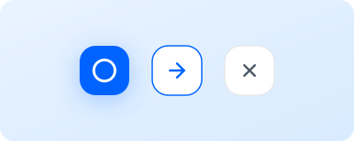
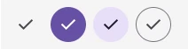
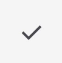
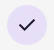
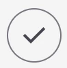
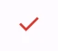
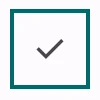

<!-- catalog-only-start --><!-- ---
name: Icon Buttons
dirname: iconbutton
-----><!-- catalog-only-end -->

<catalog-component-header>
<catalog-component-header-title slot="title">

# Icon Buttons

<!--*
# Document freshness: For more information, see go/fresh-source.
freshness: { owner: 'lizmitchell' reviewed: '2026-07-31' }
tag: 'docType:reference'
*-->

<!-- go/md-icon-button -->

<!-- [TOC] -->

<!-- external-only-start -->
**This documentation is fully rendered on the
[KakaoBank Material Web catalog](https://material-web.dev/components/icon-button/).**
<!-- external-only-end -->

[Icon buttons](https://m3.material.io/components/icon-buttons)<!-- {.external} --> help
people take supplementary actions with a single tap.

</catalog-component-header-title>


</catalog-component-header>

<!-- KakaoBank Interactive Options Playground & Live Sandbox -->
<div class="kb-playground-container">
  <div class="kb-playground-header">
    <div class="kb-playground-title">
      <span>🛠️ Icon Button (아이콘 버튼) 실시간 옵션 샌드박스</span>
      <span class="kb-playground-badge">Live Interactive</span>
    </div>
    <span style="font-size: 12px; color: #4E5968;">형태와 아이콘을 실시간으로 변경해보세요.</span>
  </div>
  <div class="kb-playground-body">
    <div class="kb-playground-controls">
      <div class="kb-control-group">
        <label class="kb-control-label" for="kb-ib-variant">버튼 형태 (Variant):</label>
        <select id="kb-ib-variant" class="kb-control-select" onchange="updateIbDemo()">
          <option value="standard" selected>Standard (기본 투명형)</option>
          <option value="filled">Filled (카카오 옐로우 채움형)</option>
          <option value="tonal">Filled Tonal (톤앤톤 그레이)</option>
          <option value="outlined">Outlined (테두리 아웃라인형)</option>
        </select>
      </div>
      <div class="kb-control-group">
        <label class="kb-control-label" for="kb-ib-icon">아이콘 선택 (Icon):</label>
        <select id="kb-ib-icon" class="kb-control-select" onchange="updateIbDemo()">
          <option value="kb_ic-arrow-left" selected>arrow-left (뒤로가기)</option>
          <option value="kb_ic-close">close (닫기)</option>
          <option value="kb_ic-call">call (고객센터 통화)</option>
          <option value="kb_ic-add">add (추가하기)</option>
          <option value="kb_ic-chevron-right">chevron-right (다음)</option>
        </select>
      </div>
      <div style="display: flex; flex-direction: column; gap: 8px; margin-top: 4px;">
        <label class="kb-control-checkbox">
          <input id="kb-ib-toggle" type="checkbox" onchange="updateIbDemo()" />
          <span>토글 버튼 활성화 (Toggle Selected)</span>
        </label>
        <label class="kb-control-checkbox">
          <input id="kb-ib-disabled" type="checkbox" onchange="updateIbDemo()" />
          <span>비활성화 (Disabled)</span>
        </label>
      </div>
    </div>
    <div class="kb-playground-canvas" id="kb-ib-canvas" style="min-height: 140px; display: flex; align-items: center; justify-content: center;">
      <button id="kb-ib-render" type="button" style="width: 48px; height: 48px; border-radius: 50%; border: none; background: transparent; display: flex; align-items: center; justify-content: center; cursor: pointer; transition: all 0.2s ease;">
        
      </button>
    </div>
  </div>
  <div class="kb-playground-footer">
    <pre class="kb-code-preview" id="kb-ib-code">&lt;md-icon-button&gt;
  &lt;md-icon&gt;&lt;img src="/../images/kb-icons/svg/kb_ic-arrow-left.svg" /&gt;&lt;/md-icon&gt;
&lt;/md-icon-button&gt;</pre>
    <button class="kb-copy-code-btn" type="button" onclick="navigator.clipboard.writeText(document.getElementById('kb-ib-code').innerText); this.innerText='복사 완료!'; setTimeout(()=>this.innerText='코드 복사', 1500)">코드 복사</button>
  </div>
</div>
<script>
  function updateIbDemo() {
    const variant = document.getElementById('kb-ib-variant').value;
    const iconName = document.getElementById('kb-ib-icon').value;
    const isToggle = document.getElementById('kb-ib-toggle').checked;
    const disabled = document.getElementById('kb-ib-disabled').checked;

    const btn = document.getElementById('kb-ib-render');
    const img = document.getElementById('kb-ib-render-img');
    const code = document.getElementById('kb-ib-code');

    img.src = '/../images/kb-icons/svg/' + iconName + '.svg';
    btn.disabled = disabled;
    btn.style.opacity = disabled ? '0.38' : '1';
    btn.style.cursor = disabled ? 'not-allowed' : 'pointer';

    let tag = 'md-icon-button';
    if (variant === 'standard') {
      btn.style.background = isToggle ? '#F8F9FA' : 'transparent';
      btn.style.border = isToggle ? '1.5px solid #191F28' : 'none';
      tag = 'md-icon-button';
    } else if (variant === 'filled') {
      btn.style.background = isToggle ? '#191F28' : '#FFE100';
      btn.style.border = 'none';
      tag = 'md-filled-icon-button';
    } else if (variant === 'tonal') {
      btn.style.background = isToggle ? '#E5E8EB' : '#F8F9FA';
      btn.style.border = 'none';
      tag = 'md-filled-tonal-icon-button';
    } else if (variant === 'outlined') {
      btn.style.background = isToggle ? '#F8F9FA' : 'transparent';
      btn.style.border = '1px solid #D1D6DB';
      tag = 'md-outlined-icon-button';
    }

    code.innerText = `<${tag} ${isToggle ? 'toggle selected' : ''} ${disabled ? 'disabled' : ''}>\n  <md-icon></md-icon>\n</${tag}>`;
  }
</script>

*   [Design article](https://m3.material.io/components/icon-buttons) <!-- {.external} -->
*   [API Documentation](#api)
*   [Source code](https://github.com/material-components/material-web/tree/main/iconbutton)
    <!-- {.external} -->

<!-- catalog-only-start -->

<!--

## Interactive Demo



-->

<!-- catalog-only-end -->

## Types

<!-- no-catalog-start -->

")

<!-- no-catalog-end -->
<!-- catalog-include "figures/iconbutton/buttons.html" -->

1.  [Icon Button](#icon-button)
2.  [Filled Icon Button](#filled-icon-button)
3.  [Filled Tonal Icon Button](#filled-tonal-icon-button)
4.  [Outlined Icon Button](#outlined-icon-button)

## Usage

Use icon buttons to display actions in a compact layout. Icon buttons can
represent opening actions such as opening an overflow menu or search, or
represent binary actions that can be toggled on and off, such as favorite or
bookmark.

Icon buttons can be grouped together or they can stand alone.

To use icons by name, see the [Icon](icon.md#usage) documentation for loading
the icon font.

<!-- no-catalog-start -->



<!-- no-catalog-end -->
<!-- catalog-include "figures/iconbutton/usage.html" -->

```html
<md-icon-button>
  <md-icon>check</md-icon>
</md-icon-button>
<md-filled-icon-button>
  <md-icon>check</md-icon>
</md-filled-icon-button>
<md-filled-tonal-icon-button>
  <md-icon>check</md-icon>
</md-filled-tonal-icon-button>
<md-outlined-icon-button>
  <md-icon>check</md-icon>
</md-outlined-icon-button>
```

### Links

Add an
[`href`](https://developer.mozilla.org/en-US/docs/Web/HTML/Element/a#href)<!-- {.external} -->
and optionally a
[`target`](https://developer.mozilla.org/en-US/docs/Web/HTML/Element/a#target)<!-- {.external} -->
attribute to turn the icon button into a link.

```html
<md-icon-button href="https://google.com">
  <md-icon>check</md-icon>
</md-icon-button>
```

### Toggle

<!-- no-catalog-start -->


<!-- no-catalog-end -->
<!-- catalog-include "figures/iconbutton/usage-toggle.html" -->

Toggle icon buttons allow a single choice to be selected or deselected, such as
adding or removing something from favorites.

Add a second icon in the `slot="selected"` slot to change the icon when
selected. Toggle icon buttons can be pre-selected by adding the `selected`
attribute.

```html
<div>
  <md-icon-button toggle>
    <md-icon>close</md-icon>
    <md-icon slot="selected">check</md-icon>
  </md-icon-button>
  <md-filled-icon-button toggle>
    <md-icon>close</md-icon>
    <md-icon slot="selected">check</md-icon>
  </md-filled-icon-button>
  <md-filled-tonal-icon-button toggle>
    <md-icon>close</md-icon>
    <md-icon slot="selected">check</md-icon>
  </md-filled-tonal-icon-button>
  <md-outlined-icon-button toggle>
    <md-icon>close</md-icon>
    <md-icon slot="selected">check</md-icon>
  </md-outlined-icon-button>
</div>
<div>
  <md-icon-button toggle selected>
    <md-icon>close</md-icon>
    <md-icon slot="selected">check</md-icon>
  </md-icon-button>
  <md-filled-icon-button toggle selected>
    <md-icon>close</md-icon>
    <md-icon slot="selected">check</md-icon>
  </md-filled-icon-button>
  <md-filled-tonal-icon-button toggle selected>
    <md-icon>close</md-icon>
    <md-icon slot="selected">check</md-icon>
  </md-filled-tonal-icon-button>
  <md-outlined-icon-button toggle selected>
    <md-icon>close</md-icon>
    <md-icon slot="selected">check</md-icon>
  </md-outlined-icon-button>
</div>
```

## Accessibility

Add an
[`aria-label`](https://developer.mozilla.org/en-US/docs/Web/Accessibility/ARIA/Attributes/aria-label)<!-- {.external} -->
attribute to icon buttons whose labels need a more descriptive label.

```html
<md-icon-button aria-label="Search for Contact">
  <md-icon>search</md-icon>
</md-icon-button>
```

### Toggle

Add an `aria-label-selected` attribute to toggle buttons whose labels need a
more descriptive label when selected.

```html
<md-icon-button toggle
  aria-label="Unselected"
  aria-label-selected="Selected">
  <md-icon>close</md-icon>
  <md-icon slot="selected">check</md-icon>
</md-icon-button>
```

### Focusable and disabled

By default, disabled icon buttons are not focusable with the keyboard, while
"soft-disabled" icon buttons are. Some use cases encourage focusability of
disabled toolbar items to increase their discoverability.

See the
[ARIA guidelines on focusability of disabled controls](https://www.w3.org/WAI/ARIA/apg/practices/keyboard-interface/#kbd_disabled_controls)<!-- {.external} -->
for guidance on when this is recommended.

```html
<div role="toolbar">
  <md-icon-button aria-label="Copy">
    <md-icon>copy</md-icon>
  </md-icon-button>
  <md-icon-button aria-label="Cut">
    <md-icon>cut</md-icon>
  </md-icon-button>
  <!--
    This icon button is disabled but kept focusable to improve its
    discoverability in the toolbar.
  -->
  <md-icon-button aria-label="Paste" soft-disabled>
    <md-icon>paste</md-icon>
  </md-icon-button>
</div>
```

## Icon Button

Standard icon buttons do not have a background or outline, and have the lowest
emphasis of the icon buttons.

<!-- no-catalog-start -->



<!-- no-catalog-end -->
<!-- catalog-include "figures/iconbutton/usage-standard.html" -->

```html
<md-icon-button>
  <md-icon>check</md-icon>
</md-icon-button>
```

## Filled Icon Button

<!-- go/md-filled-icon-button -->

<!-- no-catalog-start -->


<!-- no-catalog-end -->
<!-- catalog-include "figures/iconbutton/usage-filled.html" -->

Filled icon buttons have higher visual impact and are best for high emphasis
actions.

```html
<md-filled-icon-button>
  <md-icon>check</md-icon>
</md-filled-icon-button>
```

## Filled Tonal Icon Button

<!-- go/md-filled-tonal-icon-button -->

<!-- no-catalog-start -->



<!-- no-catalog-end -->
<!-- catalog-include "figures/iconbutton/usage-filled-tonal.html" -->

Filled tonal icon buttons are a middle ground between filled and outlined icon
buttons. They're useful in contexts where the button requires slightly more
emphasis than an outline would give, such as a secondary action paired with a
high emphasis action.

```html
<md-filled-tonal-icon-button>
  <md-icon>check</md-icon>
</md-filled-tonal-icon-button>
```

## Outlined Icon Button

<!-- go/md-outlined-icon-button -->

<!-- no-catalog-start -->



<!-- no-catalog-end -->
<!-- catalog-include "figures/iconbutton/usage-outlined.html" -->

Outlined icon buttons are medium-emphasis buttons. They're useful when an icon
button needs more emphasis than a standard icon button but less than a filled or
filled tonal icon button.

```html
<md-outlined-icon-button>
  <md-icon>check</md-icon>
</md-outlined-icon-button>
```

## Theming

Icon Button supports [Material theming](../theming/README.md) and can be
customized in terms of color, and shape.

### Icon Button tokens

Token                                | Default value
------------------------------------ | -----------------------------------
`--md-icon-button-icon-color`        | `--md-sys-color-on-surface-variant`
`--md-icon-button-state-layer-shape` | `--md-sys-shape-corner-full`
`--md-icon-button-icon-size`         | `24px`

*   [All tokens](https://github.com/material-components/material-web/blob/main/tokens/_md-comp-icon-button.scss)
    <!-- {.external} -->

### Icon Button example

<!-- no-catalog-start -->



<!-- no-catalog-end -->
<!-- catalog-include "figures/iconbutton/theming-standard.html" -->

```html
<style>
:root {
  --md-icon-button-icon-size: 32px;
  --md-sys-color-on-surface-variant: #dc362e;
  background-color: #fff8f6;
}
</style>

<md-icon-button>
  <md-icon>check</md-icon>
</md-icon-button>
```

### Filled Icon Button tokens

Token                                              | Default value
-------------------------------------------------- | -------------
`--md-filled-icon-button-selected-container-color` | `--md-sys-color-primary`
`--md-filled-icon-button-container-shape`          | `--md-sys-shape-corner-full`
`--md-filled-icon-button-container-width`          | `40px`
`--md-filled-icon-button-container-height`         | `40px`
`--md-filled-icon-button-icon-size`                | `24px`

*   [All tokens](https://github.com/material-components/material-web/blob/main/tokens/_md-comp-filled-icon-button.scss)
    <!-- {.external} -->

### Filled Icon Button example

<!-- no-catalog-start -->


<!-- no-catalog-end -->
<!-- catalog-include "figures/iconbutton/theming-filled.html" -->

```html
<style>
:root {
  --md-filled-icon-button-container-width: 80px;
  --md-filled-icon-button-container-height: 80px;
  --md-filled-icon-button-icon-size: 40px;
  --md-filled-icon-button-container-shape: 0px;
  --md-sys-color-primary: #dc362e;
  background-color: #fff8f6;
}
</style>
<md-filled-icon-button>
  <md-icon>check</md-icon>
</md-filled-icon-button>
```

### Filled Tonal Icon Button tokens

Token                                                    | Default value
-------------------------------------------------------- | -------------
`--md-filled-tonal-icon-button-selected-container-color` | `--md-sys-color-secondary-container`
`--md-filled-tonal-icon-button-container-shape`          | `--md-sys-shape-corner-full`
`--md-filled-tonal-icon-button-container-width`          | `40px`
`--md-filled-tonal-icon-button-container-height`         | `40px`
`--md-filled-tonal-icon-button-icon-size`                | `24px`

### Filled Tonal Icon Button example

<!-- no-catalog-start -->


<!-- no-catalog-end -->
<!-- catalog-include "figures/iconbutton/theming-filled-tonal.html" -->

```html
<style>
:root {
  --md-filled-tonal-icon-button-container-width: 80px;
  --md-filled-tonal-icon-button-container-height: 80px;
  --md-filled-tonal-icon-button-container-shape: 0px;
  --md-filled-tonal-icon-button-icon-size: 40px;
  --md-sys-color-secondary-container: #006A6A;
}
</style>
<md-filled-tonal-icon-button>
  <md-icon>check</md-icon>
</md-filled-tonal-icon-button>
```

### Outlined Icon Button tokens

Token                                        | Default value
-------------------------------------------- | ----------------------------
`--md-outlined-icon-button-outline-color`    | `--md-sys-color-outline`
`--md-outlined-icon-button-outline-width`    | `1px`
`--md-outlined-icon-button-container-shape`  | `--md-sys-shape-corner-full`
`--md-outlined-icon-button-container-width`  | `40px`
`--md-outlined-icon-button-container-height` | `40px`
`--md-outlined-icon-button-icon-size`        | `24px`

### Outlined Icon Button example

<!-- no-catalog-start -->



<!-- no-catalog-end -->
<!-- catalog-include "figures/iconbutton/theming-outlined.html" -->

```html
<style>
:root {
  --md-outlined-icon-button-container-width: 80px;
  --md-outlined-icon-button-container-height: 80px;
  --md-outlined-icon-button-container-shape: 0px;
  --md-outlined-icon-button-icon-size: 40px;
  --md-outlined-icon-button-outline-width: 4px;
  --md-sys-color-outline: #006A6A;
}
</style>
<md-outlined-icon-button>
  <md-icon>check</md-icon>
</md-outlined-icon-button>
```

<!-- auto-generated API docs start -->

## API


### MdIconButton <code>&lt;md-icon-button&gt;</code>

#### Properties

<!-- mdformat off(autogenerated might break rendering in catalog) -->

| Property | Attribute | Type | Default | Description |
| --- | --- | --- | --- | --- |
| `softDisabled` | `soft-disabled` | `boolean` | `false` | "Soft-disables" the icon button (disabled but still focusable).<br>Use this when an icon button needs increased visibility when disabled. See https://www.w3.org/WAI/ARIA/apg/practices/keyboard-interface/#kbd_disabled_controls for more guidance on when this is needed. |
| `flipIconInRtl` | `flip-icon-in-rtl` | `boolean` | `false` | Flips the icon if it is in an RTL context at startup. |
| `href` | `href` | `string` | `''` | Sets the underlying `HTMLAnchorElement`'s `href` resource attribute. |
| `download` | `download` | `string` | `''` | The filename to use when downloading the linked resource. If not specified, the browser will determine a filename. This is only applicable when the icon button is used as a link (`href` is set). |
| `target` | `target` | `"" \| LinkTarget` | `''` | Sets the underlying `HTMLAnchorElement`'s `target` attribute. |
| `ariaLabelSelected` | `aria-label-selected` | `string` | `''` | The `aria-label` of the button when the button is toggleable and selected. |
| `toggle` | `toggle` | `boolean` | `false` | When true, the button will toggle between selected and unselected states |
| `selected` | `selected` | `boolean` | `false` | Sets the selected state. When false, displays the default icon. When true, displays the selected icon, or the default icon If no `slot="selected"` icon is provided. |
| `name` | `name` | `string` | `undefined` | The HTML name to use in form submission. |
| `disabled` | `disabled` | `boolean` | `undefined` | Whether or not the element is disabled. |
| `type` | `type` | `string` | `'submit'` | A string indicating the form submission behavior of the element.<br>- submit: The element submits the form. This is the default value if the attribute is not specified, or if it is dynamically changed to an empty or invalid value. - reset: The element resets the form. - button: The element does nothing. |
| `value` | `value` | `string` | `''` | The value of the button. When combined with a `name`, the submitting button's name/value will be added to the form. |
| `form` |  | `HTMLFormElement` | `undefined` | The associated form element with which this element's value will submit. |
| `labels` |  | `NodeList` | `undefined` | The labels this element is associated with. |

<!-- mdformat on(autogenerated might break rendering in catalog) -->

#### Events

<!-- mdformat off(autogenerated might break rendering in catalog) -->

| Event | Type | [Bubbles](https://developer.mozilla.org/en-US/docs/Web/API/Event/bubbles) | [Composed](https://developer.mozilla.org/en-US/docs/Web/API/Event/composed) | Description |
| --- | --- | --- | --- | --- |
| `input` | `InputEvent` | Yes | Yes | Dispatched when a toggle button toggles |
| `change` | `Event` | Yes | No | Dispatched when a toggle button toggles |

<!-- mdformat on(autogenerated might break rendering in catalog) -->

### MdFilledIconButton <code>&lt;md-filled-icon-button&gt;</code>

#### Properties

<!-- mdformat off(autogenerated might break rendering in catalog) -->

| Property | Attribute | Type | Default | Description |
| --- | --- | --- | --- | --- |
| `softDisabled` | `soft-disabled` | `boolean` | `false` | "Soft-disables" the icon button (disabled but still focusable).<br>Use this when an icon button needs increased visibility when disabled. See https://www.w3.org/WAI/ARIA/apg/practices/keyboard-interface/#kbd_disabled_controls for more guidance on when this is needed. |
| `flipIconInRtl` | `flip-icon-in-rtl` | `boolean` | `false` | Flips the icon if it is in an RTL context at startup. |
| `href` | `href` | `string` | `''` | Sets the underlying `HTMLAnchorElement`'s `href` resource attribute. |
| `download` | `download` | `string` | `''` | The filename to use when downloading the linked resource. If not specified, the browser will determine a filename. This is only applicable when the icon button is used as a link (`href` is set). |
| `target` | `target` | `"" \| LinkTarget` | `''` | Sets the underlying `HTMLAnchorElement`'s `target` attribute. |
| `ariaLabelSelected` | `aria-label-selected` | `string` | `''` | The `aria-label` of the button when the button is toggleable and selected. |
| `toggle` | `toggle` | `boolean` | `false` | When true, the button will toggle between selected and unselected states |
| `selected` | `selected` | `boolean` | `false` | Sets the selected state. When false, displays the default icon. When true, displays the selected icon, or the default icon If no `slot="selected"` icon is provided. |
| `name` | `name` | `string` | `undefined` | The HTML name to use in form submission. |
| `disabled` | `disabled` | `boolean` | `undefined` | Whether or not the element is disabled. |
| `type` | `type` | `string` | `'submit'` | A string indicating the form submission behavior of the element.<br>- submit: The element submits the form. This is the default value if the attribute is not specified, or if it is dynamically changed to an empty or invalid value. - reset: The element resets the form. - button: The element does nothing. |
| `value` | `value` | `string` | `''` | The value of the button. When combined with a `name`, the submitting button's name/value will be added to the form. |
| `form` |  | `HTMLFormElement` | `undefined` | The associated form element with which this element's value will submit. |
| `labels` |  | `NodeList` | `undefined` | The labels this element is associated with. |

<!-- mdformat on(autogenerated might break rendering in catalog) -->

#### Events

<!-- mdformat off(autogenerated might break rendering in catalog) -->

| Event | Type | [Bubbles](https://developer.mozilla.org/en-US/docs/Web/API/Event/bubbles) | [Composed](https://developer.mozilla.org/en-US/docs/Web/API/Event/composed) | Description |
| --- | --- | --- | --- | --- |
| `input` | `InputEvent` | Yes | Yes | Dispatched when a toggle button toggles |
| `change` | `Event` | Yes | No | Dispatched when a toggle button toggles |

<!-- mdformat on(autogenerated might break rendering in catalog) -->

### MdFilledTonalIconButton <code>&lt;md-filled-tonal-icon-button&gt;</code>

#### Properties

<!-- mdformat off(autogenerated might break rendering in catalog) -->

| Property | Attribute | Type | Default | Description |
| --- | --- | --- | --- | --- |
| `softDisabled` | `soft-disabled` | `boolean` | `false` | "Soft-disables" the icon button (disabled but still focusable).<br>Use this when an icon button needs increased visibility when disabled. See https://www.w3.org/WAI/ARIA/apg/practices/keyboard-interface/#kbd_disabled_controls for more guidance on when this is needed. |
| `flipIconInRtl` | `flip-icon-in-rtl` | `boolean` | `false` | Flips the icon if it is in an RTL context at startup. |
| `href` | `href` | `string` | `''` | Sets the underlying `HTMLAnchorElement`'s `href` resource attribute. |
| `download` | `download` | `string` | `''` | The filename to use when downloading the linked resource. If not specified, the browser will determine a filename. This is only applicable when the icon button is used as a link (`href` is set). |
| `target` | `target` | `"" \| LinkTarget` | `''` | Sets the underlying `HTMLAnchorElement`'s `target` attribute. |
| `ariaLabelSelected` | `aria-label-selected` | `string` | `''` | The `aria-label` of the button when the button is toggleable and selected. |
| `toggle` | `toggle` | `boolean` | `false` | When true, the button will toggle between selected and unselected states |
| `selected` | `selected` | `boolean` | `false` | Sets the selected state. When false, displays the default icon. When true, displays the selected icon, or the default icon If no `slot="selected"` icon is provided. |
| `name` | `name` | `string` | `undefined` | The HTML name to use in form submission. |
| `disabled` | `disabled` | `boolean` | `undefined` | Whether or not the element is disabled. |
| `type` | `type` | `string` | `'submit'` | A string indicating the form submission behavior of the element.<br>- submit: The element submits the form. This is the default value if the attribute is not specified, or if it is dynamically changed to an empty or invalid value. - reset: The element resets the form. - button: The element does nothing. |
| `value` | `value` | `string` | `''` | The value of the button. When combined with a `name`, the submitting button's name/value will be added to the form. |
| `form` |  | `HTMLFormElement` | `undefined` | The associated form element with which this element's value will submit. |
| `labels` |  | `NodeList` | `undefined` | The labels this element is associated with. |

<!-- mdformat on(autogenerated might break rendering in catalog) -->

#### Events

<!-- mdformat off(autogenerated might break rendering in catalog) -->

| Event | Type | [Bubbles](https://developer.mozilla.org/en-US/docs/Web/API/Event/bubbles) | [Composed](https://developer.mozilla.org/en-US/docs/Web/API/Event/composed) | Description |
| --- | --- | --- | --- | --- |
| `input` | `InputEvent` | Yes | Yes | Dispatched when a toggle button toggles |
| `change` | `Event` | Yes | No | Dispatched when a toggle button toggles |

<!-- mdformat on(autogenerated might break rendering in catalog) -->

### MdOutlinedIconButton <code>&lt;md-outlined-icon-button&gt;</code>

#### Properties

<!-- mdformat off(autogenerated might break rendering in catalog) -->

| Property | Attribute | Type | Default | Description |
| --- | --- | --- | --- | --- |
| `softDisabled` | `soft-disabled` | `boolean` | `false` | "Soft-disables" the icon button (disabled but still focusable).<br>Use this when an icon button needs increased visibility when disabled. See https://www.w3.org/WAI/ARIA/apg/practices/keyboard-interface/#kbd_disabled_controls for more guidance on when this is needed. |
| `flipIconInRtl` | `flip-icon-in-rtl` | `boolean` | `false` | Flips the icon if it is in an RTL context at startup. |
| `href` | `href` | `string` | `''` | Sets the underlying `HTMLAnchorElement`'s `href` resource attribute. |
| `download` | `download` | `string` | `''` | The filename to use when downloading the linked resource. If not specified, the browser will determine a filename. This is only applicable when the icon button is used as a link (`href` is set). |
| `target` | `target` | `"" \| LinkTarget` | `''` | Sets the underlying `HTMLAnchorElement`'s `target` attribute. |
| `ariaLabelSelected` | `aria-label-selected` | `string` | `''` | The `aria-label` of the button when the button is toggleable and selected. |
| `toggle` | `toggle` | `boolean` | `false` | When true, the button will toggle between selected and unselected states |
| `selected` | `selected` | `boolean` | `false` | Sets the selected state. When false, displays the default icon. When true, displays the selected icon, or the default icon If no `slot="selected"` icon is provided. |
| `name` | `name` | `string` | `undefined` | The HTML name to use in form submission. |
| `disabled` | `disabled` | `boolean` | `undefined` | Whether or not the element is disabled. |
| `type` | `type` | `string` | `'submit'` | A string indicating the form submission behavior of the element.<br>- submit: The element submits the form. This is the default value if the attribute is not specified, or if it is dynamically changed to an empty or invalid value. - reset: The element resets the form. - button: The element does nothing. |
| `value` | `value` | `string` | `''` | The value of the button. When combined with a `name`, the submitting button's name/value will be added to the form. |
| `form` |  | `HTMLFormElement` | `undefined` | The associated form element with which this element's value will submit. |
| `labels` |  | `NodeList` | `undefined` | The labels this element is associated with. |

<!-- mdformat on(autogenerated might break rendering in catalog) -->

#### Events

<!-- mdformat off(autogenerated might break rendering in catalog) -->

| Event | Type | [Bubbles](https://developer.mozilla.org/en-US/docs/Web/API/Event/bubbles) | [Composed](https://developer.mozilla.org/en-US/docs/Web/API/Event/composed) | Description |
| --- | --- | --- | --- | --- |
| `input` | `InputEvent` | Yes | Yes | Dispatched when a toggle button toggles |
| `change` | `Event` | Yes | No | Dispatched when a toggle button toggles |

<!-- mdformat on(autogenerated might break rendering in catalog) -->

<!-- auto-generated API docs end -->
