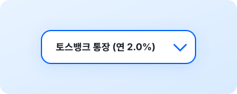
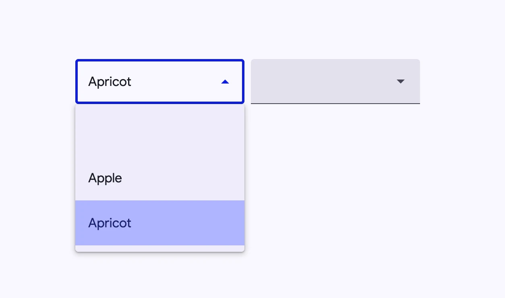
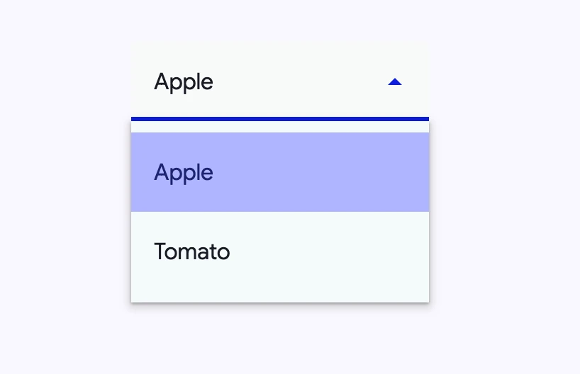
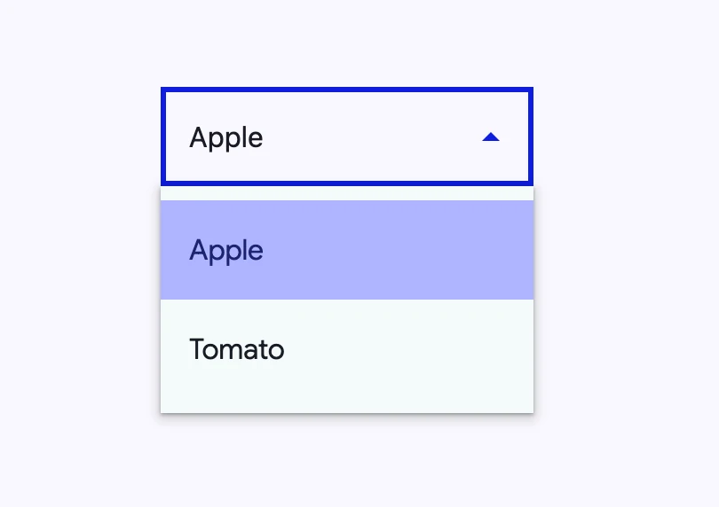

<!-- catalog-only-start --><!-- ---
name: Select
dirname: select
-----><!-- catalog-only-end -->

<catalog-component-header image-align="start">
<catalog-component-header-title slot="title">

# Select

<!-- no-catalog-start -->

<!--*
# Document freshness: For more information, see go/fresh-source.
freshness: { owner: 'material-web-team' reviewed: '2026-07-31' }
tag: 'docType:reference'
*-->

<!-- go/md-select -->

<!-- [TOC] -->

<!-- external-only-start -->
**This documentation is fully rendered on the
[KakaoBank Material Web catalog](https://material-web.dev/components/select/)**
<!-- external-only-end -->

<!-- no-catalog-end -->

[Select menus](https://m3.material.io/components/menus/overview#b1704de4-94b7-4177-9e96-b677ae767cb4)<!-- {.external} -->
display a list of choices on temporary surfaces and display the currently
selected menu item above the menu.

</catalog-component-header-title>



</catalog-component-header>

<!-- KakaoBank Interactive Options Playground & Live Sandbox -->
<div class="kb-playground-container">
  <div class="kb-playground-header">
    <div class="kb-playground-title">
      <span>🛠️ Select (드롭다운 셀렉트) 실시간 옵션 샌드박스</span>
      <span class="kb-playground-badge">Live Interactive</span>
    </div>
    <span style="font-size: 12px; color: #4E5968;">출금 계좌 및 금융 상품 선택 드롭다운을 실시간 조작해보세요.</span>
  </div>
  <div class="kb-playground-body">
    <div class="kb-playground-controls">
      <div class="kb-control-group">
        <label class="kb-control-label" for="kb-sel-variant">셀렉트 형태 (Variant):</label>
        <select id="kb-sel-variant" class="kb-control-select" onchange="updateSelectDemo()">
          <option value="outlined" selected>Outlined (테두리 아웃라인형)</option>
          <option value="filled">Filled (서피스 배경형)</option>
        </select>
      </div>
      <div class="kb-control-group">
        <label class="kb-control-label" for="kb-sel-item">기본 선택 상품 (Product):</label>
        <select id="kb-sel-item" class="kb-control-select" onchange="updateSelectDemo()">
          <option value="입출금통장 (3333-01-1234567)" selected>입출금통장 (3333-01-1234567)</option>
          <option value="카카오뱅크 26주적금">카카오뱅크 26주적금</option>
          <option value="비상금대출">비상금대출</option>
          <option value="모임통장 (3333-02-9876543)">모임통장 (3333-02-9876543)</option>
        </select>
      </div>
      <div style="display: flex; flex-direction: column; gap: 8px; margin-top: 4px;">
        <label class="kb-control-checkbox">
          <input id="kb-sel-disabled" type="checkbox" onchange="updateSelectDemo()" />
          <span>비활성화 (Disabled)</span>
        </label>
      </div>
    </div>
    <div class="kb-playground-canvas" id="kb-sel-canvas" style="min-height: 160px; display: flex; justify-content: center; align-items: center; padding: 24px;">
      <div id="kb-sel-render-box" style="width: 100%; max-width: 360px; border: 1.5px solid #D1D6DB; border-radius: 14px; background: #FFFFFF; padding: 10px 16px; display: flex; justify-content: space-between; align-items: center; cursor: pointer; transition: all 0.2s ease;">
        <div>
          <div style="font-size: 11px; font-weight: 600; color: #8B95A1;">출금 계좌 선택</div>
          <div id="kb-sel-render-text" style="font-size: 14px; font-weight: 700; color: #191F28; margin-top: 2px;">입출금통장 (3333-01-1234567)</div>
        </div>
        <span style="font-size: 12px; color: #8B95A1;">▼</span>
      </div>
    </div>
  </div>
  <div class="kb-playground-footer">
    <pre class="kb-code-preview" id="kb-sel-code">&lt;md-outlined-select label="출금 계좌 선택"&gt;
  &lt;md-select-option value="1" selected&gt;입출금통장 (3333-01-1234567)&lt;/md-select-option&gt;
&lt;/md-outlined-select&gt;</pre>
    <button class="kb-copy-code-btn" type="button" onclick="navigator.clipboard.writeText(document.getElementById('kb-sel-code').innerText); this.innerText='복사 완료!'; setTimeout(()=>this.innerText='코드 복사', 1500)">코드 복사</button>
  </div>
</div>
<script>
  function updateSelectDemo() {
    const variant = document.getElementById('kb-sel-variant').value;
    const item = document.getElementById('kb-sel-item').value;
    const disabled = document.getElementById('kb-sel-disabled').checked;

    const box = document.getElementById('kb-sel-render-box');
    const text = document.getElementById('kb-sel-render-text');
    const code = document.getElementById('kb-sel-code');

    text.innerText = item;
    box.style.opacity = disabled ? '0.4' : '1';
    box.style.cursor = disabled ? 'not-allowed' : 'pointer';

    const tag = variant === 'filled' ? 'md-filled-select' : 'md-outlined-select';
    if (variant === 'filled') {
      box.style.background = '#F9FAFB';
      box.style.border = '1px solid #E5E8EB';
    } else {
      box.style.background = '#FFFFFF';
      box.style.border = '1.5px solid #191F28';
    }

    code.innerText = `<${tag} label="출금 계좌 선택" ${disabled ? 'disabled' : ''}>\n  <md-select-option value="prod" selected>${item}</md-select-option>\n  <md-select-option value="26week">카카오뱅크 26주적금</md-select-option>\n</${tag}>`;
  }
</script>

*   Design article (*coming soon*)
*   [API Documentation](#api)
*   [Source code](https://github.com/material-components/material-web/tree/main/select)
    <!-- {.external} -->

## Usage

Select (also referred to as a dropdown menu) allows choosing a value from a
fixed list of available options. It is analogous to the native HTML
[`<select>` element](https://developer.mozilla.org/en-US/docs/Web/HTML/Element/select)<!-- {.external} -->.

<!-- no-catalog-start -->



<!-- no-catalog-end -->
<!-- catalog-include "figures/select/usage.html" -->

```html
<md-outlined-select>
  <md-select-option aria-label="blank"></md-select-option>
  <md-select-option selected value="apple">
    <div slot="headline">Apple</div>
  </md-select-option>
  <md-select-option value="apricot">
    <div slot="headline">Apricot</div>
  </md-select-option>
</md-outlined-select>

<md-filled-select>
  <md-select-option aria-label="blank"></md-select-option>
  <md-select-option value="apple">
    <div slot="headline">Apple</div>
  </md-select-option>
  <md-select-option value="apricot">
    <div slot="headline">Apricot</div>
  </md-select-option>
</md-filled-select>
```

### Required select

Indicate that a selection is mandatory by adding the `required` attribute.

```html
<md-filled-select required>
  <md-select-option value="one">
    <div slot="headline">One</div>
  </md-select-option>
  <md-select-option value="two">
    <div slot="headline">Two</div>
  </md-select-option>
</md-filled-select>
```

<!--
## Accessibility

*Insert a 1-2 sentence description of a common accessibility scenario, followed
by a code snippet. Do not include a rendered image for accessibility examples.*

```html
<component-name aria-label="Example">
```

*Repeat with additional examples as needed to explain how to make the component
accessible.* -->

## Theming

Select supports
[Material theming](https://github.com/material-components/material-web/blob/main/docs/theming/README.md)<!-- {.external} -->
and can be customized in terms of color, typography, and shape.

### Filled Select tokens

Token                                            | Default value
------------------------------------------------ | -------------
`--md-filled-select-text-field-container-color`  | `--md-sys-color-surface-container-highest`
`--md-filled-select-text-field-container-shape`  | `--md-sys-shape-corner-extra-small`
`--md-filled-select-text-field-input-text-color` | `--md-sys-color-on-surface`
`--md-filled-select-text-field-input-text-font`  | `--md-sys-typescale-body-large-font`

*   [Filled Select tokens](https://github.com/material-components/material-web/blob/main/tokens/_md-comp-filled-select.scss)
    <!-- {.external} -->

To theme the select's dropdown menu, use the `md-menu` component tokens on the
`::part(menu)` selector.

### Filled Select example

<!-- no-catalog-start -->



<!-- no-catalog-end -->
<!-- catalog-include "figures/select/theming-filled.html" -->

```html
<style>
:root {
  --md-filled-select-text-field-container-shape: 0px;
  --md-filled-select-text-field-container-color: #f7faf9;
  --md-filled-select-text-field-input-text-color: #005353;
  --md-filled-select-text-field-input-text-font: system-ui;
}

md-filled-select::part(menu) {
  --md-menu-container-color: #f4fbfa;
  --md-menu-container-shape: 0px;
}
</style>

<md-filled-select>
  <md-select-option selected value="apple">
    <div slot="headline">Apple</div>
  </md-select-option>
  <md-select-option value="tomato">
    <div slot="headline">Tomato</div>
  </md-select-option>
</md-filled-select>
```

### Outlined Select tokens

Token                                              | Default value
-------------------------------------------------- | -------------
`--md-outlined-select-text-field-outline-color`    | `--md-sys-color-outline`
`--md-outlined-select-text-field-container-shape`  | `--md-sys-shape-corner-extra-small`
`--md-outlined-select-text-field-input-text-color` | `--md-sys-color-on-surface`
`--md-outlined-select-text-field-input-text-font`  | `--md-sys-typescale-body-large-font`

*   [Outlined Select tokens](https://github.com/material-components/material-web/blob/main/tokens/_md-comp-outlined-select.scss)
    <!-- {.external} -->

### Outlined Select example

<!-- no-catalog-start -->



<!-- no-catalog-end -->
<!-- catalog-include "figures/select/theming-outlined.html" -->

```html
<style>
:root {
  --md-outlined-select-text-field-outline-color: #6e7979;
  --md-outlined-select-text-field-container-shape: 0px;
  --md-outlined-select-text-field-input-text-color: #005353;
  --md-outlined-select-text-field-input-text-font: system-ui;
}

md-outlined-select::part(menu) {
  --md-menu-container-color: #f4fbfa;
  --md-menu-container-shape: 0px;
}
</style>

<md-outlined-select>
  <md-select-option selected value="apple">
    <div slot="headline">Apple</div>
  </md-select-option>
  <md-select-option value="tomato">
    <div slot="headline">Tomato</div>
  </md-select-option>
</md-outlined-select>
```

<!-- auto-generated API docs start -->

## API


### MdFilledSelect <code>&lt;md-filled-select&gt;</code>

#### Properties

<!-- mdformat off(autogenerated might break rendering in catalog) -->

| Property | Attribute | Type | Default | Description |
| --- | --- | --- | --- | --- |
| `quick` | `quick` | `boolean` | `false` | Opens the menu synchronously with no animation. |
| `required` | `required` | `boolean` | `false` | Whether or not the select is required. |
| `errorText` | `error-text` | `string` | `''` | The error message that replaces supporting text when `error` is true. If `errorText` is an empty string, then the supporting text will continue to show.<br>This error message overrides the error message displayed by `reportValidity()`. |
| `label` | `label` | `string` | `''` | The floating label for the field. |
| `noAsterisk` | `no-asterisk` | `boolean` | `false` | Disables the asterisk on the floating label, when the select is required. |
| `supportingText` | `supporting-text` | `string` | `''` | Conveys additional information below the select, such as how it should be used. |
| `error` | `error` | `boolean` | `false` | Gets or sets whether or not the select is in a visually invalid state.<br>This error state overrides the error state controlled by `reportValidity()`. |
| `menuPositioning` | `menu-positioning` | `"absolute" \| "fixed" \| "popover"` | `'popover'` | Whether or not the underlying md-menu should be position: fixed to display in a top-level manner, or position: absolute.<br>position:fixed is useful for cases where select is inside of another element with stacking context and hidden overflows such as `md-dialog`. |
| `clampMenuWidth` | `clamp-menu-width` | `boolean` | `false` | Clamps the menu-width to the width of the select. |
| `typeaheadDelay` | `typeahead-delay` | `number` | `DEFAULT_TYPEAHEAD_BUFFER_TIME` | The max time between the keystrokes of the typeahead select / menu behavior before it clears the typeahead buffer. |
| `hasLeadingIcon` | `has-leading-icon` | `boolean` | `false` | Whether or not the text field has a leading icon. Used for SSR. |
| `displayText` | `display-text` | `string` | `''` | Text to display in the field. Only set for SSR. |
| `menuAlign` | `menu-align` | `"start" \| "end"` | `'start'` | Whether the menu should be aligned to the start or the end of the select's textbox. |
| `value` | `value` | `string` | `undefined` |  |
| `selectedIndex` | `selected-index` | `number` | `undefined` |  |
| `name` | `name` | `string` | `undefined` | The HTML name to use in form submission. |
| `disabled` | `disabled` | `boolean` | `undefined` | Whether or not the element is disabled. |
| `options` |  | `SelectOption[]` | `undefined` |  |
| `selectedOptions` |  | `SelectOption[]` | `undefined` |  |
| `form` |  | `HTMLFormElement` | `undefined` | The associated form element with which this element's value will submit. |
| `labels` |  | `NodeList` | `undefined` | The labels this element is associated with. |
| `validity` |  | `ValidityState` | `undefined` | Returns a ValidityState object that represents the validity states of the element.<br>https://developer.mozilla.org/en-US/docs/Web/API/ValidityState |
| `validationMessage` |  | `string` | `undefined` | Returns a validation error message or an empty string if the element is valid.<br>https://developer.mozilla.org/en-US/docs/Web/API/ElementInternals/validationMessage |
| `willValidate` |  | `boolean` | `undefined` | Returns whether an element will successfully validate based on forms validation rules and constraints.<br>Disabled and readonly elements will not validate.<br>https://developer.mozilla.org/en-US/docs/Web/API/ElementInternals/willValidate |

<!-- mdformat on(autogenerated might break rendering in catalog) -->

#### Methods

<!-- mdformat off(autogenerated might break rendering in catalog) -->

| Method | Parameters | Returns | Description |
| --- | --- | --- | --- |
| `select` | `value` | `void` | Selects an option given the value of the option, and updates MdSelect's value. |
| `selectIndex` | `index` | `void` | Selects an option given the index of the option, and updates MdSelect's value. |
| `reset` | _None_ | `void` | Reset the select to its default value. |
| `showPicker` | _None_ | `void` | Shows the picker. If it's already open, this is a no-op. |
| `getUpdateComplete` | _None_ | `Promise<boolean>` |  |
| `formResetCallback` | _None_ | `void` |  |
| `formStateRestoreCallback` | `state` | `void` |  |
| `click` | _None_ | `void` |  |
| `checkValidity` | _None_ | `boolean` | Checks the element's constraint validation and returns true if the element is valid or false if not.<br>If invalid, this method will dispatch an `invalid` event.<br>https://developer.mozilla.org/en-US/docs/Web/API/ElementInternals/checkValidity |
| `reportValidity` | _None_ | `boolean` | Checks the element's constraint validation and returns true if the element is valid or false if not.<br>If invalid, this method will dispatch a cancelable `invalid` event. If not canceled, a the current `validationMessage` will be reported to the user.<br>https://developer.mozilla.org/en-US/docs/Web/API/ElementInternals/reportValidity |
| `setCustomValidity` | `error` | `void` | Sets the element's constraint validation error message. When set to a non-empty string, `validity.customError` will be true and `validationMessage` will display the provided error.<br>Use this method to customize error messages reported.<br>https://developer.mozilla.org/en-US/docs/Web/API/HTMLInputElement/setCustomValidity |

<!-- mdformat on(autogenerated might break rendering in catalog) -->

#### Events

<!-- mdformat off(autogenerated might break rendering in catalog) -->

| Event | Type | [Bubbles](https://developer.mozilla.org/en-US/docs/Web/API/Event/bubbles) | [Composed](https://developer.mozilla.org/en-US/docs/Web/API/Event/composed) | Description |
| --- | --- | --- | --- | --- |
| `change` | `Event` | Yes | No | The native `change` event on [`<input>`](https://developer.mozilla.org/en-US/docs/Web/API/HTMLElement/change_event) |
| `input` | `InputEvent` | Yes | Yes | The native `input` event on [`<input>`](https://developer.mozilla.org/en-US/docs/Web/API/HTMLElement/input_event) |
| `opening` | `Event` | No | No | Fired when the select's menu is about to open. |
| `opened` | `Event` | No | No | Fired when the select's menu has finished animations and opened. |
| `closing` | `Event` | No | No | Fired when the select's menu is about to close. |
| `closed` | `Event` | No | No | Fired when the select's menu has finished animations and closed. |

<!-- mdformat on(autogenerated might break rendering in catalog) -->

### MdOutlinedSelect <code>&lt;md-outlined-select&gt;</code>

#### Properties

<!-- mdformat off(autogenerated might break rendering in catalog) -->

| Property | Attribute | Type | Default | Description |
| --- | --- | --- | --- | --- |
| `quick` | `quick` | `boolean` | `false` | Opens the menu synchronously with no animation. |
| `required` | `required` | `boolean` | `false` | Whether or not the select is required. |
| `errorText` | `error-text` | `string` | `''` | The error message that replaces supporting text when `error` is true. If `errorText` is an empty string, then the supporting text will continue to show.<br>This error message overrides the error message displayed by `reportValidity()`. |
| `label` | `label` | `string` | `''` | The floating label for the field. |
| `noAsterisk` | `no-asterisk` | `boolean` | `false` | Disables the asterisk on the floating label, when the select is required. |
| `supportingText` | `supporting-text` | `string` | `''` | Conveys additional information below the select, such as how it should be used. |
| `error` | `error` | `boolean` | `false` | Gets or sets whether or not the select is in a visually invalid state.<br>This error state overrides the error state controlled by `reportValidity()`. |
| `menuPositioning` | `menu-positioning` | `"absolute" \| "fixed" \| "popover"` | `'popover'` | Whether or not the underlying md-menu should be position: fixed to display in a top-level manner, or position: absolute.<br>position:fixed is useful for cases where select is inside of another element with stacking context and hidden overflows such as `md-dialog`. |
| `clampMenuWidth` | `clamp-menu-width` | `boolean` | `false` | Clamps the menu-width to the width of the select. |
| `typeaheadDelay` | `typeahead-delay` | `number` | `DEFAULT_TYPEAHEAD_BUFFER_TIME` | The max time between the keystrokes of the typeahead select / menu behavior before it clears the typeahead buffer. |
| `hasLeadingIcon` | `has-leading-icon` | `boolean` | `false` | Whether or not the text field has a leading icon. Used for SSR. |
| `displayText` | `display-text` | `string` | `''` | Text to display in the field. Only set for SSR. |
| `menuAlign` | `menu-align` | `"start" \| "end"` | `'start'` | Whether the menu should be aligned to the start or the end of the select's textbox. |
| `value` | `value` | `string` | `undefined` |  |
| `selectedIndex` | `selected-index` | `number` | `undefined` |  |
| `name` | `name` | `string` | `undefined` | The HTML name to use in form submission. |
| `disabled` | `disabled` | `boolean` | `undefined` | Whether or not the element is disabled. |
| `options` |  | `SelectOption[]` | `undefined` |  |
| `selectedOptions` |  | `SelectOption[]` | `undefined` |  |
| `form` |  | `HTMLFormElement` | `undefined` | The associated form element with which this element's value will submit. |
| `labels` |  | `NodeList` | `undefined` | The labels this element is associated with. |
| `validity` |  | `ValidityState` | `undefined` | Returns a ValidityState object that represents the validity states of the element.<br>https://developer.mozilla.org/en-US/docs/Web/API/ValidityState |
| `validationMessage` |  | `string` | `undefined` | Returns a validation error message or an empty string if the element is valid.<br>https://developer.mozilla.org/en-US/docs/Web/API/ElementInternals/validationMessage |
| `willValidate` |  | `boolean` | `undefined` | Returns whether an element will successfully validate based on forms validation rules and constraints.<br>Disabled and readonly elements will not validate.<br>https://developer.mozilla.org/en-US/docs/Web/API/ElementInternals/willValidate |

<!-- mdformat on(autogenerated might break rendering in catalog) -->

#### Methods

<!-- mdformat off(autogenerated might break rendering in catalog) -->

| Method | Parameters | Returns | Description |
| --- | --- | --- | --- |
| `select` | `value` | `void` | Selects an option given the value of the option, and updates MdSelect's value. |
| `selectIndex` | `index` | `void` | Selects an option given the index of the option, and updates MdSelect's value. |
| `reset` | _None_ | `void` | Reset the select to its default value. |
| `showPicker` | _None_ | `void` | Shows the picker. If it's already open, this is a no-op. |
| `getUpdateComplete` | _None_ | `Promise<boolean>` |  |
| `formResetCallback` | _None_ | `void` |  |
| `formStateRestoreCallback` | `state` | `void` |  |
| `click` | _None_ | `void` |  |
| `checkValidity` | _None_ | `boolean` | Checks the element's constraint validation and returns true if the element is valid or false if not.<br>If invalid, this method will dispatch an `invalid` event.<br>https://developer.mozilla.org/en-US/docs/Web/API/ElementInternals/checkValidity |
| `reportValidity` | _None_ | `boolean` | Checks the element's constraint validation and returns true if the element is valid or false if not.<br>If invalid, this method will dispatch a cancelable `invalid` event. If not canceled, a the current `validationMessage` will be reported to the user.<br>https://developer.mozilla.org/en-US/docs/Web/API/ElementInternals/reportValidity |
| `setCustomValidity` | `error` | `void` | Sets the element's constraint validation error message. When set to a non-empty string, `validity.customError` will be true and `validationMessage` will display the provided error.<br>Use this method to customize error messages reported.<br>https://developer.mozilla.org/en-US/docs/Web/API/HTMLInputElement/setCustomValidity |

<!-- mdformat on(autogenerated might break rendering in catalog) -->

#### Events

<!-- mdformat off(autogenerated might break rendering in catalog) -->

| Event | Type | [Bubbles](https://developer.mozilla.org/en-US/docs/Web/API/Event/bubbles) | [Composed](https://developer.mozilla.org/en-US/docs/Web/API/Event/composed) | Description |
| --- | --- | --- | --- | --- |
| `change` | `Event` | Yes | No | The native `change` event on [`<input>`](https://developer.mozilla.org/en-US/docs/Web/API/HTMLElement/change_event) |
| `input` | `InputEvent` | Yes | Yes | The native `input` event on [`<input>`](https://developer.mozilla.org/en-US/docs/Web/API/HTMLElement/input_event) |
| `opening` | `Event` | No | No | Fired when the select's menu is about to open. |
| `opened` | `Event` | No | No | Fired when the select's menu has finished animations and opened. |
| `closing` | `Event` | No | No | Fired when the select's menu is about to close. |
| `closed` | `Event` | No | No | Fired when the select's menu has finished animations and closed. |

<!-- mdformat on(autogenerated might break rendering in catalog) -->

### MdSelectOption <code>&lt;md-select-option&gt;</code>

#### Properties

<!-- mdformat off(autogenerated might break rendering in catalog) -->

| Property | Attribute | Type | Default | Description |
| --- | --- | --- | --- | --- |
| `disabled` | `disabled` | `boolean` | `false` | Disables the item and makes it non-selectable and non-interactive. |
| `selected` | `selected` | `boolean` | `false` | Sets the item in the selected visual state when a submenu is opened. |
| `value` | `value` | `string` | `''` | Form value of the option. |
| `type` |  | `string` | `'option' as const` |  |
| `typeaheadText` |  | `string` | `undefined` |  |
| `displayText` |  | `string` | `undefined` |  |

<!-- mdformat on(autogenerated might break rendering in catalog) -->

#### Events

<!-- mdformat off(autogenerated might break rendering in catalog) -->

| Event | Type | [Bubbles](https://developer.mozilla.org/en-US/docs/Web/API/Event/bubbles) | [Composed](https://developer.mozilla.org/en-US/docs/Web/API/Event/composed) | Description |
| --- | --- | --- | --- | --- |
| `close-menu` | `CustomEvent<{initiator: SelectOption, reason: Reason, itemPath: SelectOption[]}>` | Yes | Yes | Closes the encapsulating menu on closable interaction. |
| `request-selection` | `Event` | Yes | Yes | Requests the parent md-select to select this element (and deselect others if single-selection) when `selected` changed to `true`. |
| `request-deselection` | `Event` | Yes | Yes | Requests the parent md-select to deselect this element when `selected` changed to `false`. |

<!-- mdformat on(autogenerated might break rendering in catalog) -->

<!-- auto-generated API docs end -->
