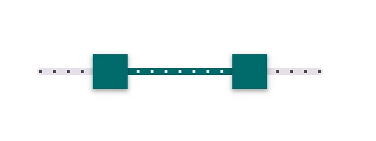

<!-- catalog-only-start --><!-- ---
name: Sliders
dirname: slider
-----><!-- catalog-only-end -->

<catalog-component-header image-align="start">
<catalog-component-header-title slot="title">

# Sliders

<!-- no-catalog-start -->

<!--*
# Document freshness: For more information, see go/fresh-source.
freshness: { owner: 'material-web-team' reviewed: '2026-07-31' }
tag: 'docType:reference'
*-->

<!-- go/md-slider -->

<!-- [TOC] -->

<!-- external-only-start -->
**This documentation is fully rendered on the
[KakaoBank Material Web catalog](https://material-web.dev/components/slider/)**
<!-- external-only-end -->

<!-- no-catalog-end -->

[Sliders](https://m3.material.io/components/sliders)<!-- {.external} --> allow users to
view and select a value (or range) along a track. They're ideal for adjusting
settings such as volume and brightness, or for applying image filters.

Sliders can use icons or labels to represent a numeric or relative scale.

</catalog-component-header-title>


</catalog-component-header>

<!-- KakaoBank Interactive Options Playground & Live Sandbox -->
<div class="kb-playground-container">
  <div class="kb-playground-header">
    <div class="kb-playground-title">
      <span>🛠️ Slider (슬라이더) 실시간 대출/적금 옵션 샌드박스</span>
      <span class="kb-playground-badge">Live Interactive</span>
    </div>
    <span style="font-size: 12px; color: #4E5968;">슬라이더를 드래그하여 기간과 대출 한도를 실시간 조절해보세요.</span>
  </div>
  <div class="kb-playground-body">
    <div class="kb-playground-controls">
      <div class="kb-control-group">
        <label class="kb-control-label" for="kb-slider-type">슬라이더 유형 (Type):</label>
        <select id="kb-slider-type" class="kb-control-select" onchange="updateSliderDemo()">
          <option value="period" selected>대출 기간 조절 (12~60개월)</option>
          <option value="amount">대출 금액 조절 (100만~5,000만원)</option>
        </select>
      </div>
      <div style="display: flex; flex-direction: column; gap: 8px; margin-top: 4px;">
        <label class="kb-control-checkbox">
          <input id="kb-slider-labeled" type="checkbox" checked onchange="updateSliderDemo()" />
          <span>값 레이블 풍선 표시 (Labeled)</span>
        </label>
        <label class="kb-control-checkbox">
          <input id="kb-slider-disabled" type="checkbox" onchange="updateSliderDemo()" />
          <span>비활성화 (Disabled)</span>
        </label>
      </div>
    </div>
    <div class="kb-playground-canvas" id="kb-slider-canvas" style="min-height: 160px; display: flex; flex-direction: column; justify-content: center; padding: 24px; box-sizing: border-box;">
      <div style="display: flex; justify-content: space-between; align-items: baseline; margin-bottom: 8px;">
        <span id="kb-slider-title" style="font-size: 14px; font-weight: 600; color: #4E5968;">대출 기간</span>
        <span id="kb-slider-val-display" style="font-size: 22px; font-weight: 800; color: #3182F6;">24개월</span>
      </div>
      <input id="kb-slider-input" type="range" min="12" max="60" step="6" value="24" oninput="updateSliderDemo()" style="width: 100%; height: 8px; accent-color: #FFE100; cursor: pointer;" />
      <div style="display: flex; justify-content: space-between; font-size: 11px; color: #8B95A1; margin-top: 6px;">
        <span id="kb-slider-min">12개월</span>
        <span id="kb-slider-max">60개월</span>
      </div>
    </div>
  </div>
  <div class="kb-playground-footer">
    <pre class="kb-code-preview" id="kb-slider-code">&lt;md-slider min="12" max="60" step="6" value="24" labeled&gt;&lt;/md-slider&gt;</pre>
    <button class="kb-copy-code-btn" type="button" onclick="navigator.clipboard.writeText(document.getElementById('kb-slider-code').innerText); this.innerText='복사 완료!'; setTimeout(()=>this.innerText='코드 복사', 1500)">코드 복사</button>
  </div>
</div>
<script>
  function updateSliderDemo() {
    const type = document.getElementById('kb-slider-type').value;
    const labeled = document.getElementById('kb-slider-labeled').checked;
    const disabled = document.getElementById('kb-slider-disabled').checked;
    const input = document.getElementById('kb-slider-input');
    const title = document.getElementById('kb-slider-title');
    const valDisplay = document.getElementById('kb-slider-val-display');
    const minSpan = document.getElementById('kb-slider-min');
    const maxSpan = document.getElementById('kb-slider-max');
    const code = document.getElementById('kb-slider-code');

    input.disabled = disabled;

    if (type === 'period') {
      title.innerText = '대출 기간';
      minSpan.innerText = '12개월';
      maxSpan.innerText = '60개월';
      input.min = '12';
      input.max = '60';
      input.step = '6';
      valDisplay.innerText = input.value + '개월';
      code.innerText = `<md-slider min="12" max="60" step="6" value="${input.value}" ${labeled ? 'labeled' : ''} ${disabled ? 'disabled' : ''} style="--md-slider-active-track-color: #FFE100; --md-slider-handle-color: #191F28;"></md-slider>`;
    } else {
      title.innerText = '대출 희망 금액';
      minSpan.innerText = '100만원';
      maxSpan.innerText = '5,000만원';
      input.min = '100';
      input.max = '5000';
      input.step = '100';
      valDisplay.innerText = Number(input.value).toLocaleString() + '만원';
      code.innerText = `<md-slider min="100" max="5000" step="100" value="${input.value}" ${labeled ? 'labeled' : ''} ${disabled ? 'disabled' : ''} style="--md-slider-active-track-color: #FFE100; --md-slider-handle-color: #191F28;"></md-slider>`;
    }
  }
</script>

*   [Design article](https://m3.material.io/components/sliders) <!-- {.external} -->
*   [API Documentation](#api)
*   [Source code](https://github.com/material-components/material-web/tree/main/slider)
    <!-- {.external} -->

<!-- catalog-only-start -->

<!--

## Interactive Demo



-->

<!-- catalog-only-end -->

## Usage

Sliders may be continuous or discrete, and may also represent a range.

```html
<md-slider></md-slider>
<md-slider ticks value="50"></md-slider>
<md-slider range value-start="25" value-end="75"></md-slider>
```

### Continuous

Allows users to select a value along a subjective range.

```html
<md-slider min="0" max="100" value="50"></md-slider>
```

### Discrete

Allows users to select a specific value from a predetermined range. Tick marks
may be used to indicate available values.

```html
<md-slider step="5" ticks min="0" max="20"></md-slider>
```

### Range

A range slider has two handles, and indicates a minimum and maximum value in a
range.

```html
<md-slider range value-start="25" value-end="50"></md-slider>
```

### Value label

A value label displays the specific value that corresponds with the handle's
placement.

The label appears when the handle is selected. For range sliders, labels appear
when either handle is selected.

```html
<md-slider labeled></md-slider>
```

<!-- TODO(b/318567101): ## Accessibility -->

## Theming

Slider supports [Material theming](../theming/README.md) and can be customized
in terms of color and shape.

### Tokens

Token                              | Default value
---------------------------------- | ------------------------------------------
`--md-slider-active-track-color`   | `--md-sys-color-primary`
`--md-slider-active-track-shape`   | `--md-sys-shape-corner-full`
`--md-slider-inactive-track-color` | `--md-sys-color-surface-container-highest`
`--md-slider-inactive-track-shape` | `--md-sys-shape-corner-full`
`--md-slider-handle-color`         | `--md-sys-color-primary`
`--md-slider-handle-shape`         | `--md-sys-shape-corner-full`

*   [All tokens](https://github.com/material-components/material-web/blob/main/tokens/_md-comp-slider.scss)
    <!-- {.external} -->

### Example

<!-- no-catalog-start -->



<!-- no-catalog-end -->

```html
<style>
:root {
  /* System tokens */
  --md-sys-color-primary: #006A6A;

  /* Component tokens */
  --md-slider-handle-shape: 0px;
}
</style>

<md-slider
  range
  value-start="25"
  value-end="75"
  ticks
  step="5"
></md-slider>
```

<!-- auto-generated API docs start -->

## API


### MdSlider <code>&lt;md-slider&gt;</code>

#### Properties

<!-- mdformat off(autogenerated might break rendering in catalog) -->

| Property | Attribute | Type | Default | Description |
| --- | --- | --- | --- | --- |
| `min` | `min` | `number` | `0` | The slider minimum value |
| `max` | `max` | `number` | `100` | The slider maximum value |
| `value` | `value` | `number` | `undefined` | The slider value displayed when range is false. |
| `valueStart` | `value-start` | `number` | `undefined` | The slider start value displayed when range is true. |
| `valueEnd` | `value-end` | `number` | `undefined` | The slider end value displayed when range is true. |
| `valueLabel` | `value-label` | `string` | `''` | An optional label for the slider's value displayed when range is false; if not set, the label is the value itself. |
| `valueLabelStart` | `value-label-start` | `string` | `''` | An optional label for the slider's start value displayed when range is true; if not set, the label is the valueStart itself. |
| `valueLabelEnd` | `value-label-end` | `string` | `''` | An optional label for the slider's end value displayed when range is true; if not set, the label is the valueEnd itself. |
| `ariaLabelStart` | `aria-label-start` | `string` | `''` | Aria label for the slider's start handle displayed when range is true. |
| `ariaValueTextStart` | `aria-valuetext-start` | `string` | `''` | Aria value text for the slider's start value displayed when range is true. |
| `ariaLabelEnd` | `aria-label-end` | `string` | `''` | Aria label for the slider's end handle displayed when range is true. |
| `ariaValueTextEnd` | `aria-valuetext-end` | `string` | `''` | Aria value text for the slider's end value displayed when range is true. |
| `step` | `step` | `number` | `1` | The step between values. |
| `ticks` | `ticks` | `boolean` | `false` | Whether or not to show tick marks. |
| `labeled` | `labeled` | `boolean` | `false` | Whether or not to show a value label when activated. |
| `range` | `range` | `boolean` | `false` | Whether or not to show a value range. When false, the slider displays a slideable handle for the value property; when true, it displays slideable handles for the valueStart and valueEnd properties. |
| `name` | `name` | `string` | `undefined` | The HTML name to use in form submission. |
| `disabled` | `disabled` | `boolean` | `undefined` | Whether or not the element is disabled. |
| `nameStart` |  | `string` | `undefined` |  |
| `nameEnd` |  | `string` | `undefined` |  |
| `form` |  | `HTMLFormElement` | `undefined` | The associated form element with which this element's value will submit. |
| `labels` |  | `NodeList` | `undefined` | The labels this element is associated with. |

<!-- mdformat on(autogenerated might break rendering in catalog) -->

#### Methods

<!-- mdformat off(autogenerated might break rendering in catalog) -->

| Method | Parameters | Returns | Description |
| --- | --- | --- | --- |
| `formResetCallback` | _None_ | `void` |  |
| `formStateRestoreCallback` | `state` | `void` |  |

<!-- mdformat on(autogenerated might break rendering in catalog) -->

#### Events

<!-- mdformat off(autogenerated might break rendering in catalog) -->

| Event | Type | [Bubbles](https://developer.mozilla.org/en-US/docs/Web/API/Event/bubbles) | [Composed](https://developer.mozilla.org/en-US/docs/Web/API/Event/composed) | Description |
| --- | --- | --- | --- | --- |
| `change` | `Event` | Yes | No | The native `change` event on [`<input>`](https://developer.mozilla.org/en-US/docs/Web/API/HTMLElement/change_event) |
| `input` | `InputEvent` | Yes | Yes | The native `input` event on [`<input>`](https://developer.mozilla.org/en-US/docs/Web/API/HTMLElement/input_event) |

<!-- mdformat on(autogenerated might break rendering in catalog) -->

<!-- auto-generated API docs end -->
